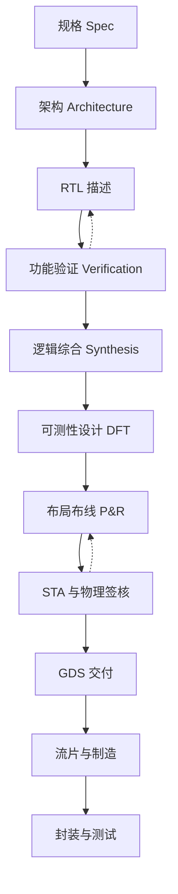
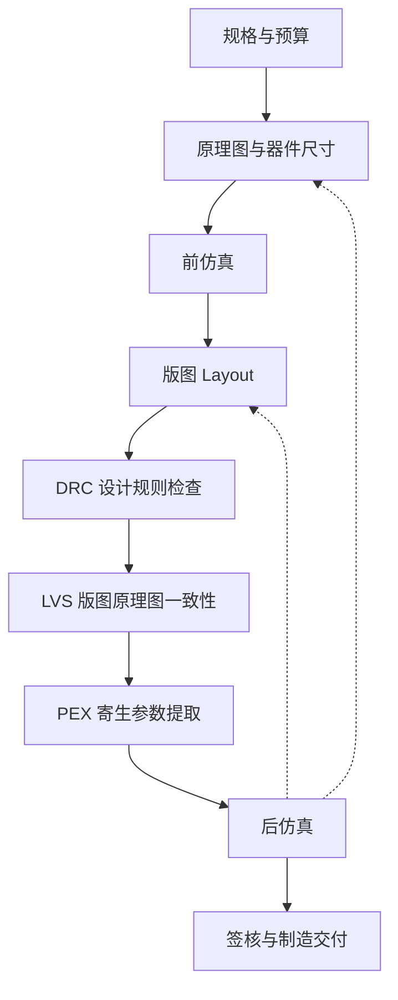

# 芯片设计全流程

芯片设计是不断把需求变成实现、再检查实现是否满足需求的过程。数字流程偏向逻辑描述和自动化实现；模拟与全定制流程更直接处理晶体管尺寸、连续信号和版图。两条主线最终都要面对制造规则、寄生效应和真实测试。

## 数字芯片：从规格到硅后测试

图表示教学上的主线，不是只执行一遍的流水线。验证贯穿各阶段；可测性设计（Design for Testability，DFT）需要在架构阶段提前规划；签核发现问题后可能回到约束、RTL 或架构。

| 环节 | 核心问题与交付物 | 常见岗位 | 代表工具或方法 |
| --- | --- | --- | --- |
| Spec 与架构 | 做什么、接口是什么、性能功耗预算多少 | 系统架构、微架构、产品工程 | 工作负载分析、C/C++/Python 模型 |
| RTL | 每个周期如何更新状态与传输数据 | 数字前端、RTL 设计 | Verilog/SystemVerilog、代码检查 |
| 功能验证 | 是否覆盖规格、边界和异常场景 | 验证、形式验证 | 仿真器、断言、UVM、形式工具 |
| 综合 | 将 RTL 映射为目标工艺的逻辑网表 | 前端实现、综合 | Genus、Design Compiler、Yosys |
| DFT | 制造后怎样观察和控制内部节点 | DFT、测试开发 | 扫描链、ATPG、存储器自测试 |
| P&R | 单元放哪里、时钟和信号怎么连 | 数字后端、物理设计 | Innovus、Fusion Compiler、OpenROAD |
| STA 与签核 | 各角落时序、电源与制造规则是否满足 | 时序、物理验证、电源完整性 | Tempus、PrimeTime、Calibre 等 |
| GDS 与流片 | 提交满足代工厂要求的制造数据 | 物理设计、项目与制造接口 | GDSII/OASIS、工艺签核清单 |
| 硅后测试 | 实际芯片是否满足功能和参数要求 | 产品、测试、硅后验证 | ATE、探针台、示波器、测试板 |

静态时序分析（Static Timing Analysis，STA）不需要枚举所有输入波形，但依赖正确的时钟、输入输出与路径约束。通过仿真不代表时序通过；时序通过也不代表功能正确。GDS 是版图数据格式，不是“芯片已经生产成功”的证明。

## 模拟与全定制：从电路到寄生后的电路

**前仿真**主要检查原理图模型；**后仿真**把布局布线产生的寄生电阻、电容等纳入分析。晶体管的匹配、走线耦合、衬底噪声与电源压降，都可能使版图后的结果偏离理想设计。

| 环节 | 需要理解的内容 | 典型岗位与工具 |
| --- | --- | --- |
| 原理图与前仿 | 偏置、小信号、稳定性、噪声、工艺角与失配 | 模拟/混合信号设计；Virtuoso、Spectre、SPICE 类工具 |
| 版图 | 匹配、对称、隔离、寄生、可制造性 | 模拟版图、全定制设计；Virtuoso Layout 等 |
| DRC | 几何图形是否满足工艺规则 | 物理验证；Calibre、Pegasus 等 |
| LVS | 版图提取的连线与器件是否对应原理图 | 版图与设计协同；LVS 工具 |
| PEX 与后仿 | 提取寄生后能否仍满足规格 | 模拟设计与签核；Quantus、寄生提取器与电路仿真器 |

设计规则检查（Design Rule Check，DRC）通过，不意味着电路连对了；版图原理图一致性检查（Layout Versus Schematic，LVS）通过，也不意味着增益、带宽或噪声已经达标。完整结论必须说明测试条件和检查边界。

## 在上科大如何逐步接触

下面是**按课程定位整理的学习入口**，不是承诺每门课覆盖表中全部工具。具体作业、软件版本及项目要求以当学期大纲为准。

| 阶段 | 上科大课程或项目入口 | 建议带着什么问题学习 |
| --- | --- | --- |
| 逻辑与时序基础 | [EE115B 数字电路](/courses/ee115b) | 组合与时序逻辑怎样区别，状态机如何验证？ |
| 数字 IC 基础与实验 | [EE113 / EE113L](/courses/ee113) | 从逻辑到晶体管、负载和延迟，抽象层如何衔接？ |
| 数字实现流程 | [EE291F 数字 VLSI 设计流程](/courses/ee291f) | 约束、综合、物理实现与结果报告怎样组成闭环？ |
| 后端工具集中实践 | [Cadence 暑期实训](/courses/cadence-summer) | 把 RTL-to-GDS 各步骤串起，而不只是记 GUI 操作 |
| 面向制造测试 | EE2210 数字集成电路可测性设计 | 为什么功能正确的设计仍需要扫描、测试结构？ |
| 真实芯片测量 | EE291J 芯片测试入门与实践（秋）；春季代码 EE291B | 如何建立激励、测量与数据分析链路？ |
| 模拟设计主线 | EE112 模拟集成电路 I、EE212 模拟集成电路 II | 如何从电路指标走到器件尺寸，再检查非理想因素？ |

<CourseTable codes="EE115B,EE113,EE113L,EE291F,EE2210,EE291J/B,EE112,EE212" />

::: info 代码与来源说明
课程组件将同名测试课合并为 `EE291J/B`；官方年度表分别列秋季 `EE291J` 与春季 `EE291B`。Cadence 实训的工具主线依据维护者课程笔记整理，属于往届安排，不代表未来学期必然沿用。
:::

第一次做项目，可以先选一个小模块：写清规格，建立自动化测试，完成综合与时序分析，再解释面积和关键路径。相比一次性运行复杂 SoC，这更容易看出每一步到底验证了什么。工具许可与环境入口见 [EDA 工具](/eda/)，完整路线见 [学习地图](/map/)。

## 参考与来源

- [2026–2027 学年官方开课表](https://faculty.sist.shanghaitech.edu.cn/office/Academics/Courses/SIST_2026-2027_Courses.htm)：课程名称、代码及先修要求。
- [学院本硕博课程体系](https://sist.shanghaitech.edu.cn/2835/list.htm)。
- 维护者提供的《Cadence 集成电路暑期实训》课程笔记：用于概括往届 RTL-to-GDS 工具链，不作为官方新学期安排。
- [Cadence](https://www.cadence.com/)、[Synopsys](https://www.synopsys.com/)、[OpenROAD](https://theopenroadproject.org/)：工具与流程介绍。工具示例不表示学院每门课程均使用该产品。
