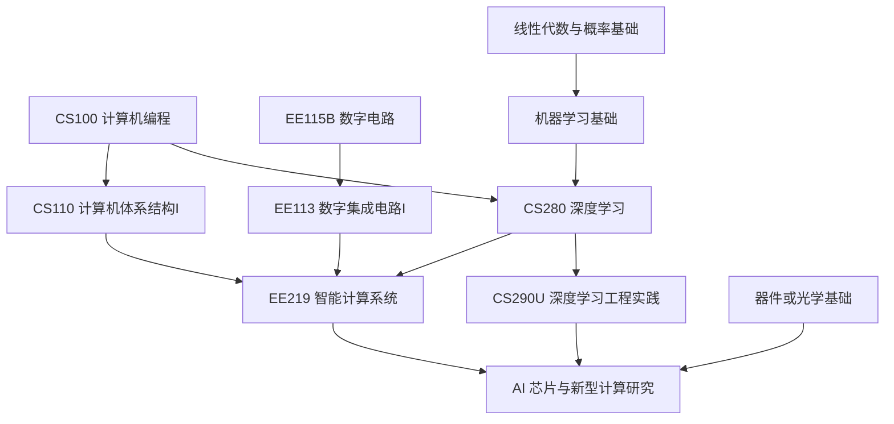

# AI 芯片与新型计算

## 这个方向在做什么

AI 芯片研究如何让机器学习模型在真实硬件上高效运行。它不仅是增加乘加单元，还要组织数据搬运、片上存储、调度和软件接口；新型计算则进一步探索不同于常规高精度数字运算的表示与物理实现，例如低比特计算、随机计算、类脑计算和光计算。这些路线有不同误差来源与适用范围，不能仅凭理论运算次数直接比较优劣。

核心研究问题包括：

- 怎样根据模型的数据依赖选择并行度、数据流与存储层级？
- 低比特量化与近似运算怎样影响任务精度和训练稳定性？
- 访存、数据转换、通信与控制会消耗多少系统能量？
- 新型器件的非理想性、随机性和漂移怎样进入计算模型？
- 硬件、编译器、运行时与算法怎样协同，而非各自优化局部指标？
- 面对不同批量、模型和输入规模，吞吐、延迟与能效能否保持？

## 上科大谁在做

上科大公开方向包含多种计算路线。刘思廷的先进计算电路与系统实验室（CAS4ET）关注动态随机计算、低比特计算与边缘 AI；中心材料介绍了基于单比特的先进计算系统及其潜在应用。娄鑫的 VSPLab 从智能视觉、三维重建与渲染芯片切入专用计算，哈亚军则研究 FPGA、超低功耗数字系统以及智能车等定制计算平台。

器件与光学侧，祝智峰研究基于自旋电子的磁存储与类脑计算；王成关注人工智能光计算芯片，曲俞睿关注光计算、光芯片与光子智能感知。它们说明“AI 硬件”并非单一技术栈：数字系统、磁性器件与光学系统需要不同知识和验证条件，应阅读各团队近期公开论文后再选择切入点。

<FacultyList dir="ai-hw" />

## 相关上科大课程

[EE219 智能计算系统](/shanghaitech/courses/ee219) 是连接算法、电路与系统的直接入口；计划中的先修说明涉及数学、EE113、编程与 HDL 基础，不宜跳过数字实现能力的积累。

<CourseTable codes="EE113,CS110,EE219,CS280,CS290U,CS290W,SI362,SI365" />

[CS290U](/shanghaitech/courses/cs290u) 可作为了解深度学习工程实践的课程入口；光计算、AI 部署与 AI 赋能芯片设计属于相邻但不同的主题，具体内容以当学期大纲为准。

## 知识前置

下图是建议的学习依赖，不是正式先修表；硬件系统与模型算法两条线最终需要汇合。

## 领域地图

- **研究机构**：MIT、Stanford、Berkeley，以及清华、复旦和中科院计算所的相关团队，覆盖加速器、存储与软硬协同等不同层级；类脑与光计算还需沿器件及光学文献扩展。
- **产业参照**：NVIDIA、AMD、Google TPU、华为昇腾等提供不同的计算系统实例；产品生态不能直接当成某种学术路线已获验证的证据，也不是本校合作名单。
- **会议与期刊**：ISCA、MICRO、HPCA、ASPLOS 偏架构与系统；ISSCC、VLSI Symposium、JSSC 偏电路和芯片；DAC、ICCAD 涉及设计方法。新型器件工作还可能出现在 IEDM 或 Nature Electronics。

比较论文必须统一任务精度、模型、批量、工艺和计时范围。峰值 TOPS 不是应用吞吐率，计算阵列的理论能效也不等于含访存与转换开销的端到端能效。

## 入门资源

- [AI 硬件自学](/learning/computer-architecture/heterogeneous-systems)、[体系结构自学](/learning/computer-architecture/general-purpose-systems)：建立模型、映射和硬件系统的共同语言。
- [数字自学](/learning/digital-ic/resources)：补 HDL、验证和实现基础。
- [MLSys Book](https://www.mlsysbook.ai/)：从机器学习系统角度组织部署与硬件知识。
- [MLCommons](https://mlcommons.org/)：理解标准化性能评测关注的工作负载、精度与规则。

入门可以先分析一个小型矩阵乘或卷积：记录数据移动量、运算量与瓶颈，再做一种可解释的优化。先复现功能与基线，不要只报告最有利输入上的速度。

## 社区经验征集

::: info 征集
欢迎相关课题组同学通过 [参与共建](/community/contributing) 补充“组里在做什么”、公开模型与硬件实践入口、进组准备建议；性能结论请说明平台、精度和测量边界。
:::

## 参考与来源

- [刘思廷学院主页](https://sist.shanghaitech.edu.cn/liust/main.htm)、[娄鑫学院主页](https://sist.shanghaitech.edu.cn/louxin/main.htm)、[哈亚军学院主页](https://sist.shanghaitech.edu.cn/hayj/main.htm)。
- [祝智峰学院主页](https://sist.shanghaitech.edu.cn/zhuzhf/main.htm)、[王成学院主页](https://sist.shanghaitech.edu.cn/wangcheng1/main.htm)、[曲俞睿学院主页](https://sist.shanghaitech.edu.cn/quyr/main.htm)。
- [后摩尔中心介绍材料](https://sist.shanghaitech.edu.cn/_upload/article/files/d0/82/218152ad4bd29c54d8a89d0e6be7/2cba84cd-d335-4a72-8f17-68175bed8e69.pdf)：约 2024 年方向介绍。
- [2026–2027 学年 SIST 开课计划](https://faculty.sist.shanghaitech.edu.cn/office/Academics/Courses/SIST_2026-2027_Courses.htm)：实际课程与先修要求以最新公布为准。
