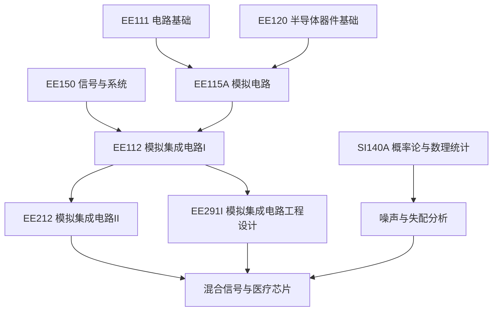

# 模拟/混合信号与生物医疗芯片

## 这个方向在做什么

现实世界的电压、电流、声音与生理信号是连续变化的，模拟电路负责放大、滤波、驱动和测量，混合信号电路（Mixed-Signal Circuits）则连接连续信号与数字处理。模数转换器（ADC）、数模转换器（DAC）、时钟和传感前端都是典型模块。生物医疗芯片在这些技术之上，还要面对极弱信号、受限能量、长时间稳定性及安全要求。

核心研究问题包括：

- 如何在噪声、带宽、线性度与功耗之间权衡？
- 工艺、电源电压和温度变化怎样影响增益、偏置与稳定性？
- 生理信号前端如何抑制共模干扰、直流偏移与运动伪迹？
- 数字开关噪声、寄生参数与版图失配怎样影响模拟模块？
- 植入或穿戴场景下，供能、通信、封装与安全边界如何协同？

## 上科大谁在做

站内师资数据将吕宏鸣及医疗集成电路与微系统实验室（BICML）列为这一方向的主要入口，公开研究重点是数模混合集成电路、脑机接口芯片与植入式医疗芯片。约 2024 年后摩尔中心材料也将实验室定位为数模混合电路设计和医疗电子系统研发。这里适合同时从电路指标和应用信号链理解问题，而不能把医疗应用仅当作普通放大器的背景标签。

相邻方向同样值得了解：[MEMS 与传感](/explore-ic/research-directions/mems-sensors) 关注信号的产生与换能，[电源管理](/explore-ic/research-directions/power) 关心供能与能量转换，[射频与电磁](/explore-ic/research-directions/rf-em) 则可能涉及无线链路与场作用。这里的关联是知识地图，不代表已建立的课题组合作关系。

<FacultyList dir="analog" />

## 相关上科大课程

先用电路、信号与模拟电路建立分析能力，再进入模拟集成电路和工程设计；研究生课程与实际项目要求应查看当学期说明。

<CourseTable codes="EE111,EE150,EE115A,EE112,EE212,EE291I,EE291H" />

[EE115A 模拟电路](/shanghaitech/courses/ee115a) 与 [EE150 信号与系统](/shanghaitech/courses/ee150) 分别提供电路级和系统级视角，两者不宜割裂学习。

## 知识前置

下图是建议路线，不是正式先修关系；器件模型与概率统计可用于进一步理解噪声和失配。

## 领域地图

- **研究机构**：Berkeley BWRC、Stanford、UC San Diego，以及清华、复旦的相关电路团队，都是模拟与混合信号论文的重要来源。医疗芯片还需结合生物医学问题选择具体团队。
- **产业参照**：Analog Devices、Texas Instruments、STMicroelectronics 的数据转换器、模拟接口与电源产品，适合用数据手册建立规格意识；不是本校合作关系清单。
- **会议与期刊**：ISSCC、VLSI Symposium、CICC、JSSC；医疗与生物接口工作也常见于 BioCAS、IEEE Transactions on Biomedical Circuits and Systems（TBioCAS）。

比较电路时先统一带宽、输入幅度、负载、电源与工艺条件。对脑机接口而言，电路噪声和功耗只是部分指标，不能据此推断临床有效性或人体使用安全。

## 入门资源

- [模拟自学](/learning/analog-ic/resources) 与 [模拟学习地图](/learning/analog-ic/)：安排小信号模型、反馈、频率响应和版图知识。
- [基础自学](/learning/fundamentals/)：补信号系统、概率与数学基础。
- [Analog Devices](https://www.analog.com/) 与 [Texas Instruments](https://www.ti.com/)：从官方教程和数据手册理解真实规格。
- [IEEE Solid-State Circuits Society](https://sscs.ieee.org/)：查找固态电路领域的教育资源与会议入口。

可以从一个简单放大器开始，依次检查直流工作点、增益带宽、稳定性、噪声和参数变化，再解释为什么加入寄生参数后表现改变。人体连接实验必须遵循实验室安全和伦理要求。

## 社区经验征集

::: info 征集
欢迎相关课题组同学通过 [参与共建](/community/contributing) 补充“组里在做什么”、公开电路训练与进组准备建议；不收集患者数据、人体实验细节或未公开芯片信息。
:::

## 参考与来源

- [吕宏鸣学院主页](https://sist.shanghaitech.edu.cn/lvhm/main.htm)、[BICML](https://bicml.shanghaitech.edu.cn/)：公开研究方向与实验室入口。
- [后摩尔中心介绍材料](https://sist.shanghaitech.edu.cn/_upload/article/files/d0/82/218152ad4bd29c54d8a89d0e6be7/2cba84cd-d335-4a72-8f17-68175bed8e69.pdf)：约 2024 年材料，不代表当前招生信息。
- [2026–2027 学年 SIST 开课计划](https://faculty.sist.shanghaitech.edu.cn/office/Academics/Courses/SIST_2026-2027_Courses.htm)：具体开课以教务系统为准。
