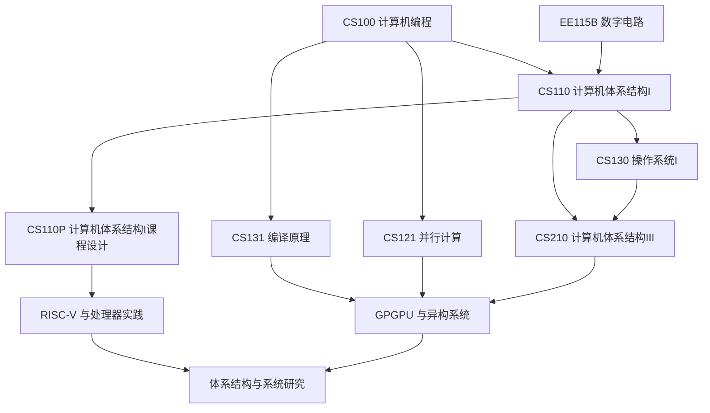

# 计算机体系结构与系统

## 这个方向在做什么

计算机体系结构（Computer Architecture）研究计算系统向软件提供什么能力，以及如何组织执行、存储与通信来高效实现这些能力。指令集架构（ISA）是软硬件约定，微架构是具体实现；两者不是同义词。系统研究进一步把操作系统、编译器、运行时、存储与真实应用纳入分析，避免只优化一个脱离使用环境的硬件模块。

核心研究问题包括：

- 流水线、乱序执行与分支预测如何隐藏延迟，又付出什么代价？
- 缓存、主存、互连和存储系统怎样支撑数据密集应用？
- 并行程序的同步、通信与负载不均衡如何限制扩展性？
- CPU、GPU 和专用加速器应怎样分工，软件接口如何匹配？
- 性能、功耗、面积与安全机制之间如何取得可测量的权衡？

## 上科大谁在做

上科大相关研究跨越电路与系统两个层次。刘思廷的公开方向包含先进计算电路与系统，中心材料提及新型计算机系统架构、边缘 AI 与低比特计算。肖原关注系统安全、微架构、侧信道攻击、可信执行环境及 x86/RISC-V，体现了架构机制与安全问题的交叉。

王春东关注数据存储与管理、操作系统与体系结构、数据安全与隐私；殷树关注高性能计算和高性能文件系统。因此，“做体系结构”不只意味着从零写 CPU，也可能是围绕数据路径、软件栈或存储系统建立可复现的实验。下面的方向标签仅作导航，不表示这些团队都在研究 GPU。

<FacultyList dir="arch" />

## 相关上科大课程

[CS110 计算机体系结构 I](/shanghaitech/courses/cs110) 是整体入口，之后可按兴趣结合并行计算、操作系统、编译与智能计算课程。

<CourseTable codes="CS100,CS110,CS110P,CS121,CS130,CS131,CS210,EE219,EE216" />

### 用开源 GPGPU 建立研究对象

通用 GPU 计算（GPGPU）是连接并行执行与完整软件栈的一条实践路线。[Vortex](https://github.com/vortexgpgpu/vortex) 基于 RISC-V 扩展提供开源 GPGPU 系统；[乘影 Ventus](https://github.com/THU-DSP-LAB/ventus-gpgpu) 则以 RISC-V 及向量扩展为基础探索 GPU 执行。可以围绕线程束调度、分支发散、访存合并与存储层级比较其设计，而不是只比较核心数量。

这些项目是公开学习与研究参照，不代表本校团队的项目归属，也不代表某门课程每年都会使用。入门建议先在原项目环境中跑通一个小程序，理解编译器、运行时、驱动与硬件的边界，再选一个局部机制做受控实验；具体接口和支持状态以项目当前文档为准。

## 知识前置

这是学习建议，不是正式先修表；架构研究也需要统计、实验设计与基本数字电路知识。

## 领域地图

- **研究机构**：Berkeley、MIT、Stanford、清华与中科院计算所是架构与系统研究的重要检索入口；Georgia Tech 的 Vortex 与清华 THU-DSP-LAB 的 Ventus 提供可阅读的开源 GPGPU 实例。
- **产业参照**：Intel、AMD、NVIDIA、Arm、华为海思的处理器与软件生态，适合对照指令集、微架构和系统接口的区别；不构成本校合作名单。
- **会议与期刊**：ISCA、MICRO、HPCA、ASPLOS，以及 ACM Transactions on Architecture and Code Optimization（TACO）、IEEE Transactions on Computers（TC）；操作系统与存储交叉问题还可关注 SOSP、OSDI、FAST。

架构实验应固定程序版本、输入、编译参数和平台配置，分清模拟周期、硬件时钟与真实运行时间。模拟器中的提升、FPGA 结果和硅片实测各有证据边界，不能互相替代。

## 入门资源

- [体系结构自学](/learning/computer-architecture/general-purpose-systems) 与 [数字自学](/learning/digital-ic/resources)：连接软件执行与硬件实现。
- [RISC-V International](https://riscv.org/)：标准与开放生态入口；使用规范时注意版本与扩展状态。
- [Vortex 项目](https://github.com/vortexgpgpu/vortex)、[Ventus 项目](https://github.com/THU-DSP-LAB/ventus-gpgpu)：以各自 README 和文档为准。
- [一生一芯](https://ysyx.oscc.cc/)：从处理器实现理解系统全栈。

## 社区经验征集

::: info 征集
欢迎相关课题组同学通过 [参与共建](/community/contributing) 补充“组里在做什么”、开源系统复现经验和进组准备建议；请给出版本与实验边界，不上传私有代码、账号或个人记录。
:::

## 参考与来源

- [刘思廷学院主页](https://sist.shanghaitech.edu.cn/liust/main.htm)、[肖原学院主页](https://sist.shanghaitech.edu.cn/xy/main.htm)、[王春东学院主页](https://sist.shanghaitech.edu.cn/wangchd/main.htm)、[殷树学院主页](https://sist.shanghaitech.edu.cn/yinshu/main.htm)。
- [后摩尔中心介绍材料](https://sist.shanghaitech.edu.cn/_upload/article/files/d0/82/218152ad4bd29c54d8a89d0e6be7/2cba84cd-d335-4a72-8f17-68175bed8e69.pdf)：约 2024 年计算系统方向介绍。
- [2026–2027 学年 SIST 开课计划](https://faculty.sist.shanghaitech.edu.cn/office/Academics/Courses/SIST_2026-2027_Courses.htm)：实际开课与课程安排以教务系统为准。
- [Vortex](https://github.com/vortexgpgpu/vortex)、[Ventus](https://github.com/THU-DSP-LAB/ventus-gpgpu)：公开项目与技术文档，不引用个人课程笔记中的进度、评价或性能排名。
