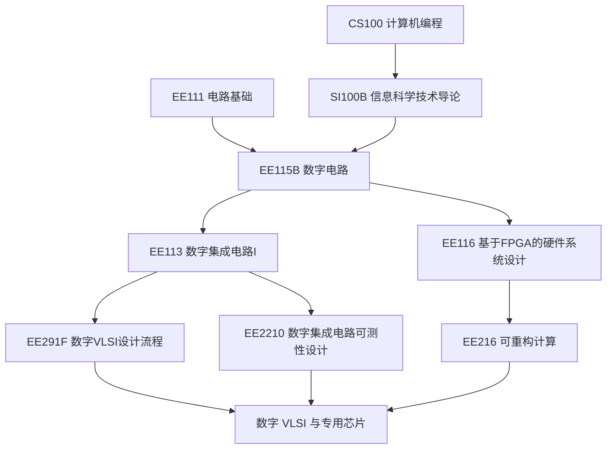

# 数字 VLSI 与专用芯片

## 这个方向在做什么

数字超大规模集成电路（Very-Large-Scale Integration，VLSI）研究如何用大量数字逻辑完成计算、控制和数据传输。专用集成电路（Application-Specific Integrated Circuit，ASIC）针对特定任务组织计算与存储；现场可编程门阵列（FPGA）提供可重配置的实现平台。两者都需要把算法映射到并行硬件，但器件资源、时序和成本约束不同。

核心研究问题包括：

- 算法应怎样流水化、并行化，才能满足真实数据依赖与带宽约束？
- 如何在功耗、性能、面积（PPA）之间做可解释的权衡？
- 片上缓存、数据复用与片外访问怎样共同决定能耗？
- 如何用验证、可测性设计和时序分析保证实现正确？
- 综合、布局布线与工艺约束会怎样反过来改变架构选择？

## 上科大谁在做

上科大数字设计的公开研究既有应用定制，也有计算方法与平台。娄鑫的 VLSI 信号处理实验室（VSPLab）研究面向图像、图形和视觉的数字集成电路与系统，站内师资数据明确列出智能视觉、三维重建与渲染芯片。它是从视觉算法走向计算结构、存储组织与芯片实现的具体入口，详见 [VSPLab 专页](/shanghaitech/research-groups/vsplab)，不要把软件渲染加速与专用芯片成果混为一谈。

哈亚军关注 FPGA 结构、设计工具及应用、超低功耗数字电路与系统，以及智能车和嵌入式系统。刘思廷关注先进计算电路与系统，包括动态随机计算、低比特计算和边缘 AI；任轩乐则连接隐私计算芯片、硬件安全与设计自动化。选择课题时，应进一步核对团队当前公开论文所采用的平台和评价方法。

<FacultyList dir="digital" />

## 相关上科大课程

可沿数字电路、数字集成电路、FPGA 和 VLSI 流程逐步建立实现能力，工程课程与进阶选修的实际内容以当学期大纲为准。

<CourseTable codes="EE115B,EE113,EE113L,EE116,EE213,EE291F,EE2210,EE216" />

[EE113](/shanghaitech/courses/ee113) 适合连接逻辑与电路实现，[EE291F](/shanghaitech/courses/ee291f) 则是理解数字设计流程的课程入口。

## 知识前置

这是建议的知识依赖，不是教务先修表；编程、基本电路和离散数学可以交叉学习。

## 领域地图

- **研究机构**：Berkeley BWRC、MIT、清华、复旦等机构的数字电路与专用计算研究，可帮助区分电路创新、架构创新和系统应用创新。
- **产业参照**：NVIDIA、AMD、华为海思的计算芯片，AMD 和 Altera 的 FPGA，以及台积电的制造平台，分别位于不同环节；不构成本校合作名单。
- **会议与期刊**：ISSCC、VLSI Symposium、CICC、JSSC 偏重电路与芯片证据；FPGA、FPL 面向可重构系统；TCAS 与 TVLSI 也有相关研究。

关注“用什么证据支持什么结论”：RTL 仿真、FPGA 原型、综合报告、布局布线结果与流片实测不是同一级别。比较 PPA 必须说明工艺、频率、精度、数据集和外部存储条件。

## 入门资源

- [数字自学](/learning/digital-ic/resources)、[数字学习地图](/learning/digital-ic/)：安排 HDL、验证与实现路径。
- [设计流程](/explore-ic/knowledge-map) 与 [开源 EDA](/tools/open-source/)：理解工具链各阶段的输入输出。
- [HDLBits](https://hdlbits.01xz.net/)：练习组合逻辑、时序逻辑和 Verilog。
- [一生一芯](https://ysyx.oscc.cc/)：系统化处理器与工程实践入口。

建议从一个有明确测试向量的小模块开始，先完成自检验证，再观察综合和时序结果。不要把“仿真看起来对”当成设计已经收敛。

## 社区经验征集

::: info 征集
欢迎数字芯片课题组同学通过 [参与共建](/community/contributing) 补充“组里在做什么”、公开项目的实现边界、验证习惯与进组准备建议；请勿披露未公开 RTL、工艺库或流片数据。
:::

## 参考与来源

- [娄鑫学院主页](https://sist.shanghaitech.edu.cn/louxin/main.htm)、[VSPLab](https://vsplab.cn/)。
- [哈亚军学院主页](https://sist.shanghaitech.edu.cn/hayj/main.htm)、[刘思廷学院主页](https://sist.shanghaitech.edu.cn/liust/main.htm)、[任轩乐学院主页](https://sist.shanghaitech.edu.cn/rxl/main.htm)。
- [后摩尔中心介绍材料](https://sist.shanghaitech.edu.cn/_upload/article/files/d0/82/218152ad4bd29c54d8a89d0e6be7/2cba84cd-d335-4a72-8f17-68175bed8e69.pdf)：约 2024 年方向材料。
- [2026–2027 学年 SIST 开课计划](https://faculty.sist.shanghaitech.edu.cn/office/Academics/Courses/SIST_2026-2027_Courses.htm)：实际开课与要求以教务系统为准。
