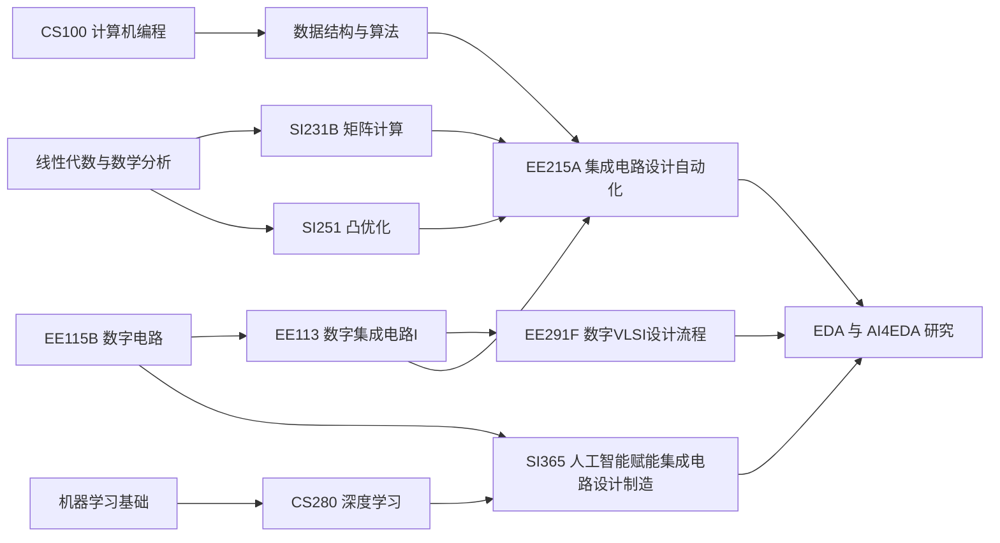

# EDA 与可制造性设计

## 这个方向在做什么

电子设计自动化（Electronic Design Automation，EDA）把电路设计中的复杂任务转化为算法、模型与工程软件，覆盖综合、验证、布局布线、仿真和签核等环节。可制造性设计（Design for Manufacturability，DFM）则关心版图在真实制造条件下能否可靠实现。AI4EDA 是用人工智能辅助这些任务，不等同于“设计 AI 芯片”，也不意味着可以绕过物理与工艺约束。

核心研究问题包括：

- 如何把逻辑、电路与版图需求表述为可求解的优化问题？
- 芯片设计空间探索（DSE）怎样平衡评估代价、搜索效率与结果质量？
- 布局布线怎样同时满足时序、拥塞、功耗与设计规则？
- 计算光刻、掩模优化和热点检测怎样连接设计与制造？
- 学习模型能否泛化到新的设计、工艺或工具配置？
- 怎样保证优化结果可验证、可复现，并能接入完整设计流程？

## 上科大谁在做

上科大公开方向包含算法、物理实现与制造接口。耿浩关注机器学习赋能 EDA，重点包括芯片设计空间探索、可制造性设计与计算光刻；中心介绍材料给出的例子包括加法器设计探索、EDA 工具参数调整、掩模优化和版图热点检测。张芯韵关注 AI 驱动的芯片设计自动化、IC 可制造性设计与物理设计，是 AI4EDA 的另一公开研究入口。

周平强的集成电路与系统实验室涉及 EDA、集成电路设计、硬件安全与光电混合计算；任轩乐关注芯片设计自动化、隐私计算芯片与硬件安全；吴涛的公开方向包含 AI 辅助集成电路设计（AI4IC）。方向存在交叉，但具体任务、数据和工具链不同，不能把一个模型在某个公开数据集上的表现泛化到整条芯片设计流程。

<FacultyList dir="eda" />

## 相关上科大课程

EE215A 集成电路设计自动化是算法与设计问题的直接入口，SI365 人工智能赋能集成电路设计制造则对应 AI 与 IC 设计制造的交叉；同时需要数字实现、数据结构和优化基础。

<CourseTable codes="CS100,EE113,EE215A,SI365,SI231B,SI251,EE291F,EE2210,CS280" />

[EE291F 数字 VLSI 设计流程](/shanghaitech/courses/ee291f) 有助于认识工具之间的关系。课程名称与计划先修仅提供选课线索，实际讲授范围、选课资格和开课情况以当学期公布为准。

## 知识前置

下图是建议学习路线，不代替教务先修要求；算法线与芯片实现线应交叉推进。

## 领域地图

- **研究机构**：Berkeley 的逻辑综合与开源设计生态、清华、复旦、香港中文大学等机构的相关团队，可作为综合、物理设计和可制造性研究的检索入口。
- **产业参照**：Cadence、Synopsys、Siemens EDA 提供不同环节的工业工具；制造企业的工艺与设计规则又决定工具需要解决的约束。这不是上科大合作关系清单。
- **会议与期刊**：DAC、ICCAD、ASP-DAC、DATE；IEEE Transactions on Computer-Aided Design of Integrated Circuits and Systems（TCAD）、ACM Transactions on Design Automation of Electronic Systems（TODAES）。

AI4EDA 尤其要防止数据泄漏和不公平比较：训练与测试是否来自同一设计的相似切片？对手方法是否有同等调参预算？最终指标是模型预测误差，还是经过真实工具评估的设计质量？论文应明确回答这些问题。

## 入门资源

- [EDA 算法自学](/learning/eda/resources) 与 [EDA 学习地图](/learning/eda/)：组织图算法、优化和学习方法。
- [开源 EDA](/tools/open-source/)、[商业 EDA](/tools/eda/commercial)、[环境配置](/tools/development/)：认识工具的适用边界与授权要求。
- [OpenROAD](https://theopenroadproject.org/)：开源数字物理实现流程入口。
- [Yosys](https://yosyshq.net/yosys/)：逻辑综合工具与文档。

起步可以在小型公开设计上选择一个单独任务，先复现基线和约束，再做局部改进。保持设计、库、工具版本和随机种子可追溯，记录运行时间与失败案例，而不只展示最好的结果。

## 社区经验征集

::: info 征集
欢迎该方向课题组同学通过 [参与共建](/community/contributing) 补充“组里在做什么”、公开数据与工具入门路径、进组准备建议；不提交商业工具许可证、受限 PDK、工艺参数或未公开设计。
:::

## 参考与来源

- [耿浩学院主页](https://sist.shanghaitech.edu.cn/genghao/main.htm)、[张芯韵学院主页](https://sist.shanghaitech.edu.cn/zxy1/main.htm)。
- [周平强学院主页](https://sist.shanghaitech.edu.cn/zhoupq/main.htm)、[任轩乐学院主页](https://sist.shanghaitech.edu.cn/rxl/main.htm)、[吴涛学院主页](https://sist.shanghaitech.edu.cn/wutao/main.htm)。
- [后摩尔中心介绍材料](https://sist.shanghaitech.edu.cn/_upload/article/files/d0/82/218152ad4bd29c54d8a89d0e6be7/2cba84cd-d335-4a72-8f17-68175bed8e69.pdf)：约 2024 年 DSE、计算光刻与 AI4IC 方向介绍。
- [2026–2027 学年 SIST 开课计划](https://faculty.sist.shanghaitech.edu.cn/office/Academics/Courses/SIST_2026-2027_Courses.htm)：EE215A、SI365 等课程的计划信息，实际以教务系统为准。
