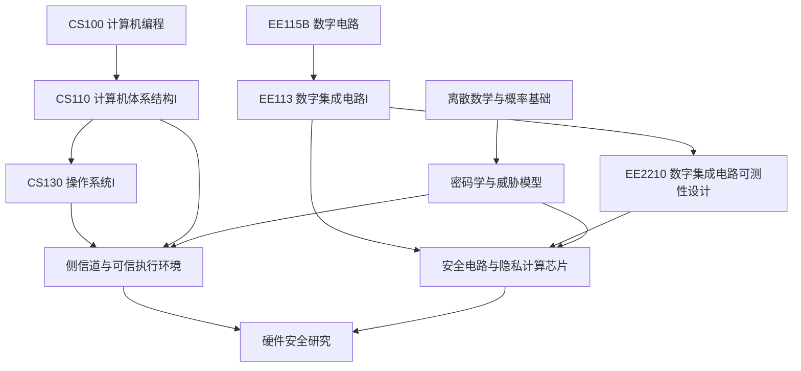

# 硬件安全与隐私计算

## 这个方向在做什么

硬件安全（Hardware Security）研究计算平台在攻击者存在时怎样保护数据、代码和执行边界。隐私计算关注在约束信息暴露的前提下完成计算，可能涉及密码协议、可信执行环境（Trusted Execution Environment，TEE）与专用加速。二者有交集，但“用了加密”不意味着实现没有泄漏，“在硬件里执行”也不自动意味着可信。

核心研究问题包括：

- 威胁模型是什么：攻击者能运行代码、观察时间，还是接触设备？
- 缓存、分支预测、功耗和电磁等可观察量会泄露什么信息？
- TEE 与隔离机制依赖哪些硬件、固件和软件假设？
- 密码与隐私计算协议如何映射为高效且实现安全的硬件？
- 如何检测或约束硬件木马、供应链篡改与设计缺陷？
- 安全机制带来的性能、面积和功耗代价能否清晰量化？

## 上科大谁在做

上科大的相关公开方向横跨系统与芯片。肖原关注系统安全、微架构、侧信道攻击、可信执行环境及 x86/RISC-V，适合从处理器和系统机制理解安全边界。任轩乐关注隐私计算芯片设计、硬件安全与芯片设计自动化，连接计算任务、实现方法和安全需求。

周平强的集成电路与系统实验室公开方向包含硬件安全，同时涉及 EDA 和集成电路设计；哈亚军的方向包含 FPGA、超低功耗数字系统与硬件安全。不同团队所说的“安全”可能位于不同层次，联系前应阅读具体论文中的攻击面、可信假设与评价平台，而不是仅依据方向标签。

<FacultyList dir="security" />

## 相关上科大课程

站内课程数据暂未单列硬件安全领域，以下选取数字实现、系统与可测性方面的相关基础课，不将其等同于专门的安全课程。

<CourseTable codes="CS110,CS130,EE113,EE116,EE2210,EE215A" />

[CS110](/shanghaitech/courses/cs110) 有助于建立处理器执行视角，[EE113](/shanghaitech/courses/ee113) 连接电路实现；具体安全知识需结合公开教材和论文补充，课程内容以当学期大纲为准。

## 知识前置

下图为建议学习路径，不代表正式先修要求；密码学与安全实验规范是需要另行补充的知识。

## 领域地图

- **研究机构**：MIT、ETH Zurich、清华、复旦等机构的相关团队可作为系统安全与硬件安全的检索入口；要继续按密码实现、微架构、验证或供应链问题细分。
- **产业参照**：Intel、AMD、Arm 的可信执行与隔离相关技术，以及芯片安全 IP 与验证工具生态，可用于分析公开威胁模型；产品名不能代替安全证明，也不表示本校合作。
- **会议与期刊**：IEEE S&P、USENIX Security、ACM CCS、NDSS 覆盖广义系统安全；CHES/TCHES 关注密码硬件与实现，HOST 关注硬件安全。DAC、ICCAD 也有安全设计相关工作。

阅读时先找攻击前提、攻击对象、成功判据和防御假设。某平台未复现攻击，不等于不存在风险；一个防御挡住某种攻击，也不意味着覆盖所有侧信道。

## 入门资源

- [体系结构自学](/learning/computer-architecture/general-purpose-systems) 与 [数字自学](/learning/digital-ic/resources)：理解微架构与电路实现。
- [论文阅读指南](/research/paper-reading)：练习拆解威胁模型、实验和局限。
- [IACR](https://www.iacr.org/)：密码研究与会议入口。
- [USENIX](https://www.usenix.org/)：查找安全论文、公开演讲和会议资料。

练习应限于自有或明确授权的隔离环境，优先复现教学示例和公开基准。不要对校园系统、共享服务器或他人设备开展未授权扫描、侧信道采集或漏洞利用；发现真实问题应遵循负责任披露流程。

## 社区经验征集

::: info 征集
欢迎相关课题组同学通过 [参与共建](/community/contributing) 补充“组里在做什么”、公开学习路线与进组准备建议；不收集可识别个人的数据、敏感密钥、未披露漏洞或未授权攻击记录。
:::

## 参考与来源

- [肖原学院主页](https://sist.shanghaitech.edu.cn/xy/main.htm)、[任轩乐学院主页](https://sist.shanghaitech.edu.cn/rxl/main.htm)。
- [周平强学院主页](https://sist.shanghaitech.edu.cn/zhoupq/main.htm)、[哈亚军学院主页](https://sist.shanghaitech.edu.cn/hayj/main.htm)。
- [后摩尔中心介绍材料](https://sist.shanghaitech.edu.cn/_upload/article/files/d0/82/218152ad4bd29c54d8a89d0e6be7/2cba84cd-d335-4a72-8f17-68175bed8e69.pdf)：约 2024 年研究方向材料，不代表当前招生承诺。
- [2026–2027 学年 SIST 开课计划](https://faculty.sist.shanghaitech.edu.cn/office/Academics/Courses/SIST_2026-2027_Courses.htm)：相关课程基础与实际开课以最新公布为准。
