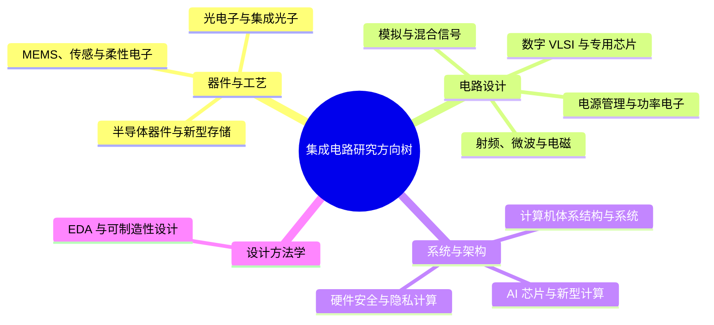

# 科研方向巡礼

<TopologyGraph />

悬停可高亮关联关系，点击方向进入详情，点击教授查看主页。

## 一张方向树

下面按主要研究对象分成四簇，共 11 个方向。这是导航，不是学科边界：一个课题可能同时涉及器件、电路、算法与软件，图中的关联也不代表正式合作或招生关系。

## 方向巡礼

### 半导体器件与新型存储

研究晶体管、存储单元与新材料结构如何产生可用的电学行为，关注的不只是尺寸，还有可靠性、能耗和制造条件。上科大相关公开方向包括自旋电子、磁存储、宽禁带器件与低温电子学。喜欢从物理机制解释实验曲线，可以从这里出发，再追问器件怎样进入电路。→ [器件与新型存储](/explore-ic/research-directions/devices)

### 光电子与集成光子

把产生、传输、调制和探测光的功能做进芯片，连接通信、感知与计算。上科大相关研究覆盖高速探测器、激光器、光互联、非线性与量子光芯片以及光计算。它既需要电磁场与器件基础，也常常需要控制电路、封装和系统测量。→ [光电子与集成光子](/explore-ic/research-directions/photonics)

### MEMS、传感与柔性电子

微机电系统（MEMS）让微小结构的运动、振动或形变成为可读出的信号。上科大的相关方向包括压电微系统、柔性电子、多层级微纳传感与精密电磁传感。这里常见的挑战是机械、电学、材料和封装相互影响，不能只看单一器件指标。→ [MEMS、传感与柔性电子](/explore-ic/research-directions/mems-sensors)

### 数字 VLSI 与专用芯片

超大规模集成电路（VLSI）设计把算法变成满足时序、功耗与面积约束的数字硬件。上科大的相关方向包含 FPGA、低功耗电路、先进计算与视觉专用芯片；[VSPLab](/shanghaitech/research-groups/vsplab) 的三维重建与渲染芯片是值得关注的入口。会写硬件描述语言只是起点，验证、存储组织和物理实现同样重要。→ [数字 VLSI 与专用芯片](/explore-ic/research-directions/digital-vlsi)

### 模拟与混合信号

模拟电路处理真实世界的连续信号，混合信号电路连接模拟域与数字域。上科大的公开研究中，医疗电子、脑机接口与植入式芯片是鲜明的应用入口。噪声、失真、功耗和安全边界必须一起考虑，而不是把理想公式直接搬到版图。→ [模拟与混合信号](/explore-ic/research-directions/analog-mixed)

### 电源管理与功率电子

这一方向研究如何高效、稳定地转换和分配能量，从芯片电源到系统级变换器都有问题。上科大相关研究包括电源管理芯片、算力电源、无线传能、能量收集与宽禁带器件应用。喜欢电路又关心控制、磁性元件和实际负载，可以沿这条线探索。→ [电源管理与功率电子](/explore-ic/research-directions/power)

### 射频、微波与电磁

频率升高后，连线、封装和空间结构本身都会参与信号传播，必须把电路与场结合起来理解。上科大相关方向包括天线、微波与毫米波器件、超构表面、太赫兹器件和电磁成像。研究可能落在通信前端，也可能落在传感、成像或电磁设计方法。→ [射频、微波与电磁](/explore-ic/research-directions/rf-em)

### AI 芯片与新型计算

研究如何让智能算法在计算、访存、精度和能耗约束下高效运行。上科大的相关路线既有数字计算电路与边缘 AI，也有自旋类脑计算和光计算，不能把它们视作同一种技术。[EE219 智能计算系统](/shanghaitech/courses/ee219) 可作为连接算法与硬件的课程入口。→ [AI 芯片与新型计算](/explore-ic/research-directions/ai-hardware)

### 计算机体系结构与系统

关注指令、流水线、缓存、并行执行和系统软件如何协同支撑真实程序。上科大相关研究横跨先进计算电路、操作系统、存储系统、高性能计算与微架构安全。可以从 [CS110](/shanghaitech/courses/cs110) 建立整体图景，再借 RISC-V 与开源 GPGPU 找到可复现的研究对象。→ [计算机体系结构与系统](/explore-ic/research-directions/architecture)

### 硬件安全与隐私计算

研究计算平台怎样在攻击者存在时仍然守住机密性、完整性和隔离边界。上科大的相关公开方向包含侧信道、可信执行环境、硬件安全与隐私计算芯片。一个设计是否安全取决于威胁模型和证据，而不只是使用了某种加密算法。→ [硬件安全与隐私计算](/explore-ic/research-directions/hardware-security)

### EDA 与可制造性设计

电子设计自动化（EDA）把逻辑、电路和版图问题转化为算法、优化与工程工具。上科大相关方向包括 AI4EDA、设计空间探索、物理设计、可制造性设计和计算光刻。适合既喜欢算法、数学，又愿意理解真实芯片约束的同学；EE215A 与 SI365 是相关课程入口。→ [EDA 与可制造性设计](/explore-ic/research-directions/eda)

## 如何选方向

**自底向上：从课程中找兴趣。** 留意自己更愿意追问哪类问题：为什么器件曲线如此变化，为什么电路会振荡，为什么程序访存受限，还是为什么一个优化器难以收敛？课程成绩不是兴趣的唯一证据；能否持续阅读、动手和解释失败更有参考价值。

**自顶向下：从产业或科研问题反推。** 例如“让边缘视觉系统更省电”可能牵涉传感、低比特计算、存储层级和电源管理。先划清问题、评价指标和实验资源，再决定自己的切入层级，不必一开始就锁定某个热门标签。

**与 [学习地图](/learning/) 配合。** 方向页用于认识问题和团队，学习地图用于安排基础与实践。可以先选一个相邻方向做小型阅读或复现实验，把“对标签感兴趣”变成“对具体问题有判断”；联系课题组前查阅近期论文和最新主页，招生信息以学院及老师公布为准。

::: info 征集
如果你在相关课题组做过科研，欢迎通过 [参与共建](/community/contributing) 补充公开的研究问题、入门路径与进组准备建议，不提交个人隐私或未公开成果。
:::

## 参考与来源

- [上海科技大学信息科学与技术学院](https://sist.shanghaitech.edu.cn/)：教授卡片链接对应公开个人主页。
- [后摩尔器件与集成系统中心介绍材料](https://sist.shanghaitech.edu.cn/_upload/article/files/d0/82/218152ad4bd29c54d8a89d0e6be7/2cba84cd-d335-4a72-8f17-68175bed8e69.pdf)：约 2024 年材料，仅用于方向介绍，不作为当前招生或人员状态证明。
- [2026–2027 学年 SIST 开课计划](https://faculty.sist.shanghaitech.edu.cn/office/Academics/Courses/SIST_2026-2027_Courses.htm)：实际开课以教务系统为准。
- [VSPLab](https://vsplab.cn/)：数字视觉与图形芯片研究入口。
