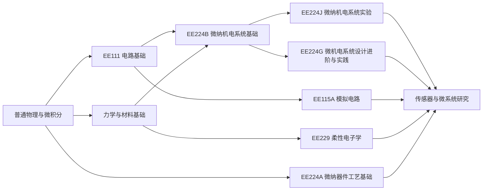

# MEMS、传感与柔性电子

## 这个方向在做什么

微机电系统（Micro-Electro-Mechanical Systems，MEMS）把机械结构、换能器与电子接口做到微小尺度；进一步缩小的结构常称 NEMS。传感研究关心如何把压力、加速度、磁场或生理变化变成可靠信号，柔性电子则探索器件和系统在弯曲、拉伸甚至贴附人体时如何工作。它们有交集，但并非所有传感器都是 MEMS，也并非所有柔性器件都用于穿戴。

核心研究问题包括：

- 如何用压电、电容、电阻或磁电效应实现高效换能？
- 谐振频率、品质因数、灵敏度与带宽怎样相互制约？
- 温漂、应力、工艺偏差与封装如何改变器件特性？
- 柔性材料与刚性芯片之间怎样形成可靠互连？
- 弱信号读出、电源与数据处理如何和传感结构协同设计？

## 上科大谁在做

上科大的相关方向横跨微纳器件与传感系统。吴涛的 SMALL 实验室关注 MEMS/NEMS、压电器件与微系统；中心材料具体提到压电射频滤波器、超声换能器、磁电/声光传感器及脑机接口器件。曹文翰的公开方向包括柔性电子器件、软体机器人、太赫兹超表面器件与多层级微纳传感器件，体现了材料、结构和功能集成的交叉。

系统侧也有不同入口：梁俊睿研究环境能量收集、无源物联网、功率管理集成电路与机电一体化；叶朝锋关注电磁精密传感、电磁无损检测、弱磁测量和信号/图像处理。约 2024 年中心材料还介绍了任豪的 MEMS 谐振器、穿戴与植入式传感及微型能源器件；站内数据注明尚未检索到当前个人页，因此不能据此判断现阶段任职或招生状态。

<FacultyList dir="mems" />

## 相关上科大课程

器件工艺、MEMS 设计与实验可以相互配合，柔性电子另有专门课程；具体实验条件和选课要求以课程公布为准。

<CourseTable codes="EE111,EE224A,EE224B,EE224J,EE224G,EE229" />

## 知识前置

下图组织概念上的学习顺序，不代表正式先修要求；材料力学、振动与多物理场基础可按课题补充。

## 领域地图

- **研究机构**：Berkeley、MIT、清华和中科院上海微系统所都有微系统相关研究；柔性电子可关注 Northwestern 等机构的相关团队。检索时应按换能机制与应用场景细分。
- **产业参照**：Bosch、STMicroelectronics 的 MEMS 传感器，TDK 的传感与声学器件，适合观察封装、可靠性和量产规格如何约束设计；不表示本校合作关系。
- **会议与期刊**：IEEE MEMS、TRANSDUCERS、IEEE SENSORS；Journal of Microelectromechanical Systems（JMEMS）、Microsystems & Nanoengineering、Sensors and Actuators 系列。

读传感论文时，不应只比较最高灵敏度。测量范围、噪声谱、检测限、响应时间、迟滞和温度条件共同决定器件能否使用；人体相关应用还涉及伦理审批与生物兼容性要求。

## 入门资源

- [器件自学](/learning/devices-and-process/resources)：理解工艺、器件和材料基础。
- [模拟自学](/learning/analog-ic/resources)：学习放大、滤波、噪声和传感读出接口。
- [nanoHUB](https://nanohub.org/)：查找微纳器件教学与仿真材料。
- [IEEE Sensors Council](https://ieee-sensors.org/)：了解传感领域会议与教育入口。

建议先针对一种传感器写清“被测量—换能机制—读出量—校准方法”四项，再复现公开模型。涉及微纳加工、高压、激光或人体实验时，应在授权场地和指导下开展。

## 社区经验征集

::: info 征集
欢迎该方向课题组同学通过 [参与共建](/community/contributing) 补充“组里在做什么”、公开仿真与测量训练路径，以及进组前的基础准备；设备使用条件请引用正式规定。
:::

## 参考与来源

- [吴涛学院主页](https://sist.shanghaitech.edu.cn/wutao/main.htm)、[SMALL](https://small.shanghaitech.edu.cn/)、[曹文翰学院主页](https://sist.shanghaitech.edu.cn/cwh/main.htm)。
- [梁俊睿学院主页](https://sist.shanghaitech.edu.cn/liangjr/main.htm)、[叶朝锋学院主页](https://sist.shanghaitech.edu.cn/yechf/main.htm)。
- [后摩尔中心介绍材料](https://sist.shanghaitech.edu.cn/_upload/article/files/d0/82/218152ad4bd29c54d8a89d0e6be7/2cba84cd-d335-4a72-8f17-68175bed8e69.pdf)：任豪相关内容为约 2024 年历史材料，当前信息以学院为准。
- [2026–2027 学年 SIST 开课计划](https://faculty.sist.shanghaitech.edu.cn/office/Academics/Courses/SIST_2026-2027_Courses.htm)。
