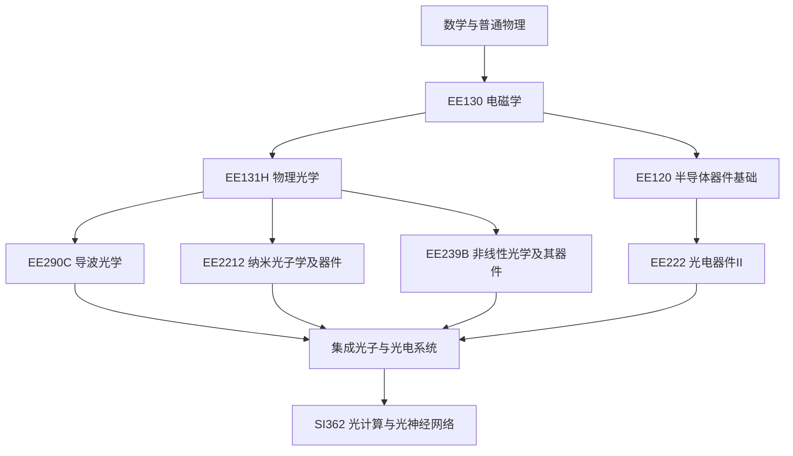

# 光电子与集成光子

## 这个方向在做什么

光电子学研究光与电子系统之间的转换，集成光子学（Integrated Photonics）则把波导、调制器、谐振器等光学结构集成到芯片上。它可以服务于高速互联、光通信、激光雷达、精密测量，也能探索光计算与量子信息。这里的“芯片”不一定使用纯硅材料，不同材料平台的光学性能、制造条件和集成方式差异很大。

核心研究问题包括：

- 如何在探测速度、响应度、噪声与工作电压之间取得平衡？
- 光源、波导、调制与探测怎样在材料及封装层面集成？
- 如何减小传播损耗、耦合损耗和温度漂移？
- 怎样利用非线性效应实现频率转换、光频梳或量子光源？
- 光计算的优势能否覆盖调制、探测、校准和数据转换的系统开销？

## 上科大谁在做

上科大在这一方向有从器件到系统的多条公开路线。陈佰乐关注雪崩光电二极管、高速光电探测芯片、III-V 族光子芯片以及硅基集成激光器和探测器；王成的方向包括人工智能光计算芯片、半导体激光器、激光通信与激光雷达。邹毅的 EZLab 侧重集成光子学、光互联、光电融合芯片与微纳光子学。

陆娟娟的 iNQuP 实验室研究光子集成电路、非线性光子学和量子光子学；中心介绍材料进一步列出低损耗光芯片、光频梳、非线性频率转换和量子光源。曲俞睿关注光计算、光芯片、光子智能感知与微纳光子学；周平强的公开方向包含光电混合计算，可作为连接器件与设计方法的另一入口。具体课题请继续阅读卡片中的主页与近期论文。

<FacultyList dir="photonics" />

## 相关上科大课程

先补电磁学与物理光学，再按器件、导波、非线性或计算兴趣选择进阶课程；表中按领域列出计划课程，实际开课以教务系统为准。

<CourseTable area="photonics" />

## 知识前置

这是学习建议图，不是正式先修表；量子光学路线还需要进一步学习量子力学。

## 领域地图

- **研究机构**：MIT、Stanford、UCSB，以及清华、浙江大学、中科院半导体所等都有光电子或集成光子相关研究；检索时要区分材料器件、光路设计与系统应用。
- **产业参照**：Intel 的硅光、台积电的光电集成相关技术、Coherent 的光电子器件，展示了不同的产业切入点；并非本校合作关系清单。
- **会议与期刊**：OFC 偏光通信与互联，CLEO 覆盖激光与光电子；Optica、Light: Science & Applications、ACS Photonics、Journal of Lightwave Technology（JLT）是常见阅读入口。

比较论文时要看工作波长、材料平台、片上还是离片光源，以及损耗与功耗是否把封装和控制电路算进去。光学矩阵运算的速度不能直接当成完整 AI 系统的吞吐率。

## 入门资源

- [器件自学](/learning/devices-and-process/resources) 与 [基础自学](/learning/fundamentals/)：补电磁场、半导体与数学基础。
- [AI 硬件自学](/learning/computer-architecture/heterogeneous-systems)：理解光计算面向的工作负载与系统指标。
- [MIT OpenCourseWare](https://ocw.mit.edu/)：检索光学、电磁场与半导体相关公开课程。
- [Optica](https://www.optica.org/) 与 [OFC](https://www.ofcconference.org/)：了解领域术语、会议主题和教育资源。

起步时可选一个环形谐振器或光电探测器，分别画出结构、输入输出量和关键损耗项。先回答“它在系统中替代什么”，再考虑复杂的片上系统。

## 社区经验征集

::: info 征集
欢迎相关课题组同学通过 [参与共建](/community/contributing) 补充“组里在做什么”、公开的光学仿真与测量入门建议，以及进组前适合准备的基础知识。
:::

## 参考与来源

- [陈佰乐学院主页](https://sist.shanghaitech.edu.cn/chenbl/main.htm)、[王成学院主页](https://sist.shanghaitech.edu.cn/wangcheng1/main.htm)、[邹毅学院主页](https://sist.shanghaitech.edu.cn/zouyi/main.htm)。
- [陆娟娟学院主页](https://sist.shanghaitech.edu.cn/lujj/main.htm)、[曲俞睿学院主页](https://sist.shanghaitech.edu.cn/quyr/main.htm)、[周平强学院主页](https://sist.shanghaitech.edu.cn/zhoupq/main.htm)。
- [后摩尔中心介绍材料](https://sist.shanghaitech.edu.cn/_upload/article/files/d0/82/218152ad4bd29c54d8a89d0e6be7/2cba84cd-d335-4a72-8f17-68175bed8e69.pdf)：约 2024 年方向介绍，不作为当前招生依据。
- [2026–2027 学年 SIST 开课计划](https://faculty.sist.shanghaitech.edu.cn/office/Academics/Courses/SIST_2026-2027_Courses.htm)：课程信息以最新公布为准。
