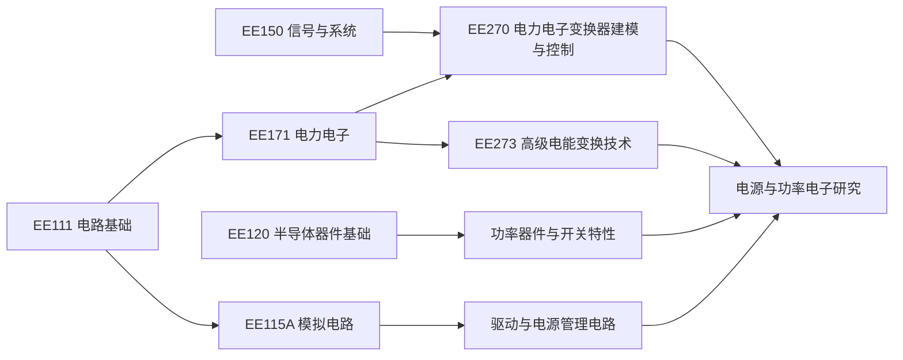

# 电源管理与功率电子

## 这个方向在做什么

功率电子（Power Electronics）研究电能的变换与控制，电源管理集成电路（Power Management IC，PMIC）则把部分控制、驱动或功率功能集成到芯片中。它连接半导体器件、控制理论、磁性元件、散热与负载需求，尺度可以从微瓦级能量收集延伸到大功率变换系统。高效率不是唯一目标，动态响应、可靠性和电磁兼容同样决定系统能否工作。

核心研究问题包括：

- 如何选择变换拓扑、开关频率和器件，平衡损耗、体积与成本？
- 输入与负载变化时，怎样保证稳定性和快速响应？
- 宽禁带器件的高速开关怎样影响驱动、寄生与电磁干扰？
- 算力负载的快速电流变化如何影响供电网络与电源控制？
- 无线传能和能量收集在弱耦合、低输入条件下怎样维持有效供能？

## 上科大谁在做

上科大的相关公开研究分布在电气与器件方向。王浩宇的 PEARL 实验室研究电力电子、电源管理芯片、算力电源与电动汽车；傅旻帆关注电力电子、无线传能、脑机接口充电、功率 IC、射频功放、电磁兼容及宽禁带器件应用。两条线都与电能转换有关，但具体系统规模与应用约束需要看近期论文。

梁俊睿关注环境能量收集、无源物联网、功率管理集成电路与机电一体化，连接低功耗传感和能源系统。邹新波的宽禁带半导体功率器件与陷阱物性研究提供器件层入口。选择课题时，可先区分自己更关注“器件为何损耗”“电路如何转换”还是“系统怎样控制”，再选择合适的基础与实践。

<FacultyList dir="power" />

## 相关上科大课程

电路基础之后可以从 EE171 进入电力电子，并用建模控制与高级变换课程继续深入；实际开课和选课条件以当学期公布为准。

<CourseTable codes="EE111,EE115A,EE171,EE270,EE273,EE291H,EE120" />

## 知识前置

这是概念学习路径，不替代正式先修表；控制理论、磁性元件与散热知识应按应用补充。

## 领域地图

- **研究机构**：Virginia Tech 的 CPES、ETH Zurich 的相关电力电子团队，以及清华、浙江大学的相关团队，可用于观察器件、变换器与控制的不同研究层次。
- **产业参照**：Infineon、Texas Instruments、Analog Devices 的功率器件与电源产品，以及电动汽车、服务器电源等应用生态；不表示上科大合作关系。
- **会议与期刊**：APEC、ECCE，以及 IEEE Transactions on Power Electronics（TPEL）、IEEE Journal of Emerging and Selected Topics in Power Electronics；集成电源电路也可关注 ISSCC、CICC、JSSC。

比较效率时必须看输入输出电压、负载范围、开关频率、器件温度和外围元件。峰值效率不能代表全负载表现，芯片控制电路的功耗也不能直接代替整机损耗。

## 入门资源

- [模拟自学](/learning/analog-ic/resources) 与 [器件自学](/learning/devices-and-process/resources)：分别补电路控制接口与功率器件基础。
- [电路与数学基础](/learning/fundamentals/)：复习动态系统和频域分析。
- [IEEE Power Electronics Society](https://www.ieee-pels.org/)：领域会议、期刊与教育入口。
- [Texas Instruments](https://www.ti.com/)：用电源产品数据手册和官方应用资料练习规格分析。

入门可先分析低压 Buck 变换器，列出能量流、关键波形和损耗项，再研究闭环响应。涉及市电、高压、大电流和储能元件的实验必须在合规场地与指导下进行，不能照搬网上电路直接接电。

## 社区经验征集

::: info 征集
欢迎相关课题组同学通过 [参与共建](/community/contributing) 补充“组里在做什么”、公开的低压实验与仿真入门路线、进组准备建议；安全规范应引用实验室正式要求。
:::

## 参考与来源

- [王浩宇学院主页](https://sist.shanghaitech.edu.cn/wanghy/main.htm)、[PEARL](https://pearl.shanghaitech.edu.cn)。
- [傅旻帆学院主页](https://sist.shanghaitech.edu.cn/fumf/main.htm)、[梁俊睿学院主页](https://sist.shanghaitech.edu.cn/liangjr/main.htm)、[邹新波学院主页](https://sist.shanghaitech.edu.cn/zouxb/main.htm)。
- [后摩尔中心介绍材料](https://sist.shanghaitech.edu.cn/_upload/article/files/d0/82/218152ad4bd29c54d8a89d0e6be7/2cba84cd-d335-4a72-8f17-68175bed8e69.pdf)：功率器件相关历史方向介绍。
- [2026–2027 学年 SIST 开课计划](https://faculty.sist.shanghaitech.edu.cn/office/Academics/Courses/SIST_2026-2027_Courses.htm)。
