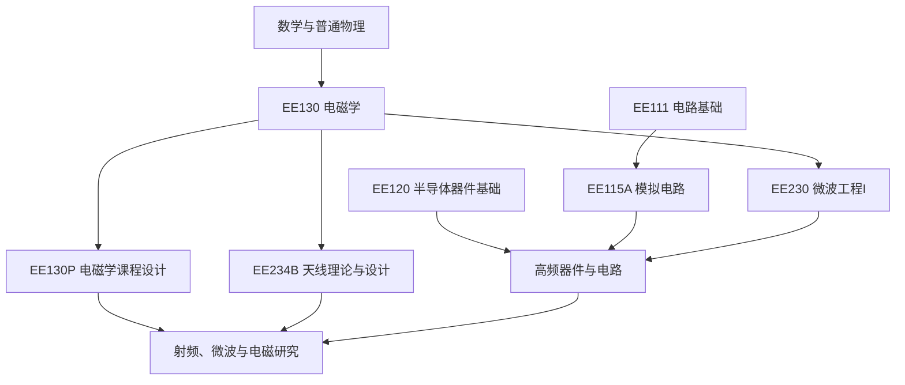

# 射频、微波与电磁

## 这个方向在做什么

射频（Radio Frequency，RF）与微波研究高频信号的产生、传输、辐射、接收和相互作用。当结构尺寸与波长可比时，连线不再只是理想导线，分布参数、传播相位和空间场分布都必须纳入设计。因此，这个方向既有晶体管与电路，也有天线、传输线、材料和电磁场计算。

核心研究问题包括：

- 怎样在增益、噪声、线性度、带宽与效率之间权衡射频前端？
- 天线的辐射、匹配、极化与阵列耦合如何共同影响系统？
- 微波、毫米波和太赫兹器件受哪些材料及工艺约束？
- 超构表面如何调控电磁波，实际损耗和带宽限制是什么？
- 如何从测得的场或散射信息恢复目标结构，实现成像与感知？
- AI 辅助电磁设计怎样满足物理约束并接受独立验证？

## 上科大谁在做

上科大相关公开研究覆盖场、器件与系统。林丰涵的超感知实验室关注模式与结构电磁学、天线理论与技术、微波电路与器件、电磁波调控及 AI 辅助电磁设计。王雄的方向包括微波/毫米波/超声生物医学成像、电磁波与声波调控、超构表面和物理神经网络，这条路线强调场作用与成像问题。

器件侧，邹新波关注 GaN 基微波与毫米波器件及宽禁带陷阱物性，曹文翰的方向包含太赫兹超表面器件。廖立杨研究面向量子信息、射频器件与电源管理的自旋电子学混合系统；傅旻帆的公开方向还包括射频功放、无线传能和电磁兼容。这些关联不表示所有课题都属于射频集成电路设计，应根据具体论文判断研究对象。

<FacultyList dir="rf" />

## 相关上科大课程

从电磁学建立场与波的语言，再进入微波工程和天线课程；电路与器件课程有助于理解有源前端。

<CourseTable codes="EE130,EE130P,EE230,EE234B,EE111,EE115A,EE120" />

## 知识前置

下图给出建议学习路线，不代表正式先修关系；复数、向量分析、微分方程与数值计算应同步补齐。

## 领域地图

- **研究机构**：MIT、UCLA、清华、东南大学与电子科技大学的相关团队，可作为高频电路、天线和电磁研究的检索起点。要区分器件物理、场求解与通信系统等不同问题。
- **产业参照**：Qualcomm、Broadcom、Qorvo 的射频产品，以及 Keysight、Rohde & Schwarz 的测试体系，有助于认识系统规格与测量条件；并非本校合作名单。
- **会议与期刊**：IMS、RFIC，以及 IEEE Transactions on Microwave Theory and Techniques（TMTT）；天线与传播方向关注 IEEE AP-S/URSI 和 IEEE Transactions on Antennas and Propagation（TAP）。集成射频电路也常见于 ISSCC、JSSC。

比较指标时要注明频段、带宽、参考阻抗与测量参考面。芯片、探针、封装、连接线和天线的损耗不能随意混算；仿真结果也不能自动当作实测结果。

## 入门资源

- [模拟自学](/learning/analog-ic/resources)、[器件自学](/learning/devices-and-process/resources)：分别补有源电路与器件知识。
- [基础自学](/learning/fundamentals/)：补电磁场所需数学与信号分析。
- [IEEE Microwave Theory and Technology Society](https://mtt.org/)：微波领域会议、期刊与教育资源。
- [IEEE Antennas and Propagation Society](https://www.ieeeaps.org/)：天线与传播方向入口。

可先学习传输线与阻抗匹配，用一个简单结构连接等效电路、全波模型与测量量。射频发射、强场和高功率实验须遵守频谱管理及实验室安全要求。

## 社区经验征集

::: info 征集
欢迎该方向课题组同学通过 [参与共建](/community/contributing) 补充“组里在做什么”、公开仿真与仪器学习路径、进组准备建议；不披露未公开参数、设备账号或受限资料。
:::

## 参考与来源

- [林丰涵学院主页](https://sist.shanghaitech.edu.cn/linfh/main.htm)、[王雄学院主页](https://sist.shanghaitech.edu.cn/wangxiong/main.htm)。
- [邹新波学院主页](https://sist.shanghaitech.edu.cn/zouxb/main.htm)、[曹文翰学院主页](https://sist.shanghaitech.edu.cn/cwh/main.htm)、[廖立杨学院主页](https://sist.shanghaitech.edu.cn/lly1/main.htm)、[傅旻帆学院主页](https://sist.shanghaitech.edu.cn/fumf/main.htm)。
- [后摩尔中心介绍材料](https://sist.shanghaitech.edu.cn/_upload/article/files/d0/82/218152ad4bd29c54d8a89d0e6be7/2cba84cd-d335-4a72-8f17-68175bed8e69.pdf)：约 2024 年方向介绍。
- [2026–2027 学年 SIST 开课计划](https://faculty.sist.shanghaitech.edu.cn/office/Academics/Courses/SIST_2026-2027_Courses.htm)：课程安排以教务系统为准。
