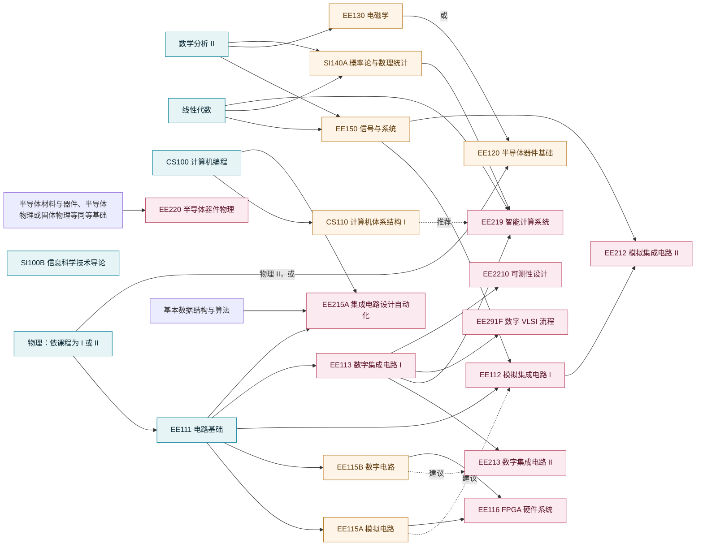

# 学习地图 {#学习地图总览}

学习地图不是一张“全部修完才能科研”的清单，而是用来找下一步、查知识缺口的导航。上科大 EE 的数学、物理、电路与编程基础可以通向多条路线；选一条主线，再为具体项目补交叉知识，通常比同时追逐所有热门方向更有效。

::: warning 三种信息不要混用
**2026 级培养方案**规定培养要求并给出建议修读学期；**2026–2027 学年开课计划**描述该学年的开课与先修信息；本 Wiki 的**路线建议**是学习安排，不是选课资格证明。研究生课程能否由本科生修读，以及当学期是否开课，均以学院和教务系统为准。
:::

## 上科大 IC 课程承接网络

图依据官方年度表的先修栏整理，压缩掉部分实验课与跨方向课程。**实线表示表中明确列出的先修知识；虚线表示表中明确标注的建议。**标有“或”的两条边是替代条件，不是同时要求。节点颜色区分层次：青色为基础层，橙色为专业基础与承接层，红色为按方向选修的进阶层；未着色节点为非课程形式的前置知识。图不是完整的选课校验器；未画出的条件见下文说明。

### 读图时特别注意

- **SI100B** 是早期接触信息技术的入口，但年度表未将它写成上述各课的统一先修，因此图中没有人为添加箭头。
- **EE113** 的官方先修原文为 `EE111,EE115`。年度表又将基础电路分别列为 `EE115A`、`EE115B`，这里不擅自把旧式 `EE115` 等同为某个新代码；选课时须核对大纲或向任课教师确认。
- **SI140A** 还要求编程基础知识；图中未把它强行绑定为某一门编程课程。
- **EE219** 还推荐 CS100/CS110、Verilog/VHDL 和一定 Python 基础；图只画出部分关系，不能仅凭三条实线判定准备充分。
- **EE220** 的先修写的是器件、半导体物理或固体物理等同等课程，而非唯一指定 EE120，所以不画“EE120 修完即可选 EE220”的强制链。
- **EE213** 另建议 Circuit Analysis；EE115B 的建议关系与 EE113 的先修关系不能互相替代。

## 用法一：自底向上

适合尚未确定方向的新生。按培养方案完成数学、物理、SI100B 和电路编程基础；在模拟电路、数字电路、信号与系统、电磁学中观察自己的兴趣。每个阶段做一个小实验：画出波形、写出测试、分析一张频响或器件曲线。

2026 级 EE 方案中，SI100B 建议大一秋修读，EE111/EE111L 为大一春；EE115A/EE115B 与 EE150/EE150L 安排在大二的不同学期组合，CS100 在大二春。EE130/EE130P 的建议学期为大二春或大三秋。不要把年度表面向其他年级或专业的班次，直接当成自己的培养方案。

## 用法二：自顶向下

适合已经有目标项目的同学。例如想做处理器，先看 RTL、验证和体系结构需要什么，再回查数字电路与编程；想做低噪声放大器，则倒推偏置、反馈、噪声、电磁与器件模型。倒推知识可以提高学习效率，但不能绕过正式的先修与选课规则。

开始科研也不等于把图全部点亮。先选能完成的小问题，明确所需知识、工具权限和可验证结果；涉及流片、洁净室、仪器或商业软件时，先通过课程或平台的正式授权流程。

## 四条路线入口

::: tip 数字 IC 与体系结构
从逻辑、RTL 到处理器与加速器，适合喜欢离散系统、编程和性能分析的同学。[进入数字路线](/map/digital)
:::

::: tip 模拟、射频与电源
从电路、信号到接口、通信和能量转换，适合喜欢连续模型、波形与实验的同学。[进入模拟路线](/map/analog)
:::

::: tip 器件、工艺与光电
从材料与载流子到器件、制造和光电子，适合喜欢物理机制和实验表征的同学。[进入器件路线](/map/device)
:::

::: tip EDA 与设计方法学
从编程、算法和电路约束到自动化实现，适合喜欢优化、软件和工程闭环的同学。[进入 EDA 路线](/map/eda)
:::

课程全表见 [课程体系](/courses/)，课外基础见 [自学资源](/self-learning/)，找课题组从 [科研方向](/research/) 出发。

## 参考与来源

- [学院本科生培养入口](https://sist.shanghaitech.edu.cn/2833/list.htm)：2026 级 EE 培养方案，本文依据其官方文件本地摘录整理。
- [2026–2027 学年开课计划](https://faculty.sist.shanghaitech.edu.cn/office/Academics/Courses/SIST_2026-2027_Courses.htm)：本图先修关系的主要依据。
- [学院本硕博课程体系与课程图谱入口](https://sist.shanghaitech.edu.cn/2835/list.htm)。
