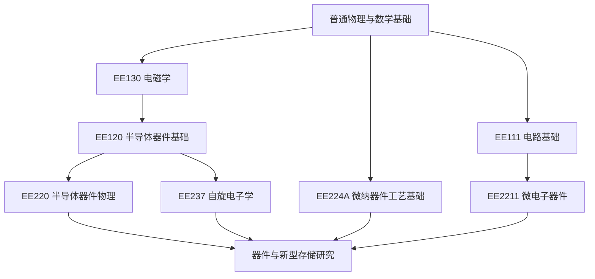

# 半导体器件与新型存储

## 这个方向在做什么

器件研究回答“用什么物理结构实现开关、存储和信号转换”。传统晶体管依靠电荷输运工作，自旋电子学（Spintronics）还利用电子自旋与磁性状态；宽禁带半导体则为高压、高温、高频场景提供不同于硅的设计空间。新机制不自动等于好芯片，必须把可重复性、工艺兼容性与电路接口一起评估。

核心研究问题包括：

- 如何在电压、速度、保持时间与写入寿命之间权衡存储单元？
- 材料界面、缺陷与陷阱如何影响漏电、噪声和动态特性？
- 如何利用自旋、磁性或低维结构实现新的功能？
- 低温、高场或大功率条件下，已有模型何时失效？
- 怎样把单器件的实验结果转化为可集成、可制造的阵列与电路？

## 上科大谁在做

上科大相关研究并非只有一条“缩小晶体管”的路线。寇煦丰的公开方向包含微纳电子器件与电路、自旋电子学、拓扑量子体系应用和低温电子学；杨雨梦关注磁存储与磁传感器，祝智峰关注基于自旋电子的磁存储和类脑计算。三者都涉及磁性与电子器件，但具体研究问题不能简单互换。

另一条线是器件与应用系统的连接：邹新波研究第三代半导体功率器件、GaN 基微波与毫米波器件及陷阱物性；廖立杨关注面向量子信息、射频器件和芯片电源管理的自旋电子学混合系统。封松林的公开方向包括微系统、量子器件与低维半导体；陈佰乐的光电探测与 III-V 族器件则连接到 [光电子方向](/research/photonics)。下列卡片按站内方向标签展示，不表示每位老师都研究本页所有主题。

<FacultyList dir="devices" />

## 相关上科大课程

可从 EE120 建立器件基础，再结合兴趣选择器件物理、工艺或自旋电子学；选课资格与正式先修要求以当学期大纲为准。

<CourseTable codes="EE120,EE220,EE2211,EE224A,EE237,EE291C" />

## 知识前置

下图是建议学习路径，不替代教务系统的先修关系；物理、微积分、线性代数应贯穿学习过程。

## 领域地图

- **研究机构**：可从 Berkeley、Stanford 的电子器件研究、清华与北大的微电子相关团队、中国科学院微电子所和上海微系统所了解不同材料及器件路线。选择具体课题组时，应查看近期论文而非只看机构名。
- **产业参照**：台积电、Intel、三星的制造与存储技术，Infineon 的功率半导体，有助于理解工艺平台与器件指标之间的联系；这不是上科大合作名单。
- **会议与期刊**：IEDM、VLSI Symposium 的器件技术方向，以及 IEEE Transactions on Electron Devices（TED）、IEEE Electron Device Letters（EDL）。自旋与新材料工作也常见于 Nature Electronics、Physical Review 系列等期刊。

读论文时先找测试结构、偏置条件、温度和统计样本，再看亮眼指标。单次测到的低能耗，不等于可量产阵列的系统能耗。

## 入门资源

- [器件自学路线](/self-learning/device) 与 [器件学习地图](/map/device)：安排物理、器件模型和工艺知识。
- [器件与工艺基础](/explore-ic/devices-process)：先掌握常用工艺与术语。
- [nanoHUB](https://nanohub.org/)：器件教学、模型与仿真资源。
- [IEEE Electron Devices Society](https://eds.ieee.org/)：查找器件领域会议、期刊与教育活动。

一个合适的起步练习是选定一种器件，画出结构、能带和等效电路，再解释一组公开的电流—电压曲线；不要在尚未理解模型适用范围时直接比较不同论文的数字。

## 社区经验征集

::: info 征集
欢迎该方向课题组同学通过 [参与共建](/about/contribute) 补充“组里在做什么”、公开实验技能与进组准备建议；请区分已公开研究和未公开结果，不提交个人评价或隐私。
:::

## 参考与来源

- [寇煦丰学院主页](https://sist.shanghaitech.edu.cn/kouxf/main.htm)、[杨雨梦学院主页](https://sist.shanghaitech.edu.cn/yangym1/main.htm)、[祝智峰学院主页](https://sist.shanghaitech.edu.cn/zhuzhf/main.htm)。
- [邹新波学院主页](https://sist.shanghaitech.edu.cn/zouxb/main.htm)、[廖立杨学院主页](https://sist.shanghaitech.edu.cn/lly1/main.htm)、[封松林学院主页](https://sist.shanghaitech.edu.cn/fengsl/main.htm)。
- [后摩尔中心介绍材料](https://sist.shanghaitech.edu.cn/_upload/article/files/d0/82/218152ad4bd29c54d8a89d0e6be7/2cba84cd-d335-4a72-8f17-68175bed8e69.pdf)：约 2024 年方向材料。
- [2026–2027 学年 SIST 开课计划](https://faculty.sist.shanghaitech.edu.cn/office/Academics/Courses/SIST_2026-2027_Courses.htm)：开课、教师与课程要求以最新公布为准。
