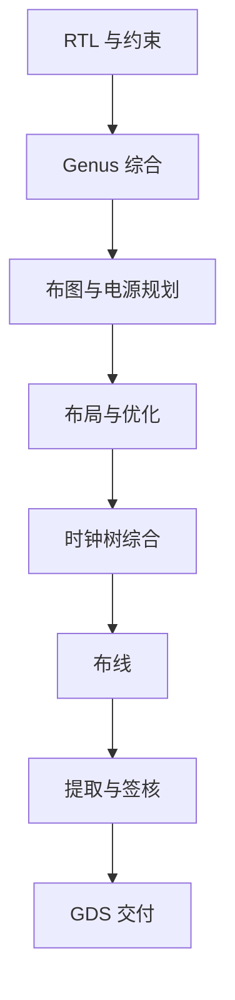

# Cadence 集成电路暑期实训

::: info 版本与性质
本页依据维护者 **2026 夏版本**实训笔记重写，记录当年的学习内容，不是常设课程招生承诺。现有资料未确认可对应官方开课表的统一课程代码，因此不放 CourseTable，也不推定学分、报名资格或下一届名额。具体组织、报名与认定以学院通知为准。
:::

## 课程定位

这是理解数字后端的实践入口：将寄存器传输级（Register-Transfer Level，RTL）设计经过综合、物理实现与签核，形成版图交付物。2026 夏笔记记录实训在 7 月开展，以理论讲解、工具 Lab、RISC-V 项目演示与问答串联学习。

建议具备[数字电路](/shanghaitech/courses/ee115b)、HDL 与基本时序概念，会使用 Linux；[EE113](/shanghaitech/courses/ee113)有助于解释电路与寄生代价，[EE291F](/shanghaitech/courses/ee291f)可补充工程管理、库、约束和综合。这里是学习建议，不是已核实的官方报名先修条件。

本实训与 EE113L 的全定制设计不同：后者强调手画器件级原理图与版图，这里主要通过标准单元与数字实现工具组织后端流程。

## 内容主线

2026 夏笔记的核心模块包括：

| 模块 | 工具与对象 | 关键问题 |
| --- | --- | --- |
| 数据库与时序基础 | LEF、DEF、Liberty、SDC；Tempus | 工艺、几何、时序模型与约束各描述什么？ |
| 综合 | Genus | RTL 如何映射为满足约束的门级网表？ |
| 布图与电源 | Innovus | 核心区、宏单元、引脚和电源网络是否合理？ |
| 布局、时钟树与布线 | Innovus / CCOpt | 如何平衡拥塞、时延、时钟偏斜和保持时间？ |
| 寄生与时序签核 | Quantus、Tempus | 布线寄生加入后，目标模式和工艺角是否仍满足要求？ |
| 物理与电源签核 | Pegasus、Voltus | 设计规则、连接一致性、功耗与供电完整性如何检查？ |

静态时序分析（Static Timing Analysis，STA）贯穿各阶段，而不是布线结束后才第一次打开报告。每一步应知道进入条件、输出数据库，以及失败后应回到哪里修改。

## 实验 / 项目

2026 夏经验记录了 DTMF 教学案例与贯穿实训的 RISC-V 项目；阶段检查涉及综合、布图与电源规划、布局布线和签核，最后进行成果展示与问答。不同项目的设计规模和工艺不能直接比较。

建议每个阶段保存四类材料：**输入配置、执行脚本、日志 / 报告、可继续运行的数据库**。交接给下一阶段前，先核对网表、约束、库与寄生文件来自同一次设计，而非从多个“看上去最好”的运行中拼接。

进阶练习可以做多频率功耗、性能与面积（Power, Performance and Area，PPA）对比。重点是保持约束、活动率、工艺角和统计口径一致，并说明哪些指标来自实现估计、哪些来自签核。不要把某份往届项目的频率或功耗当作全班必须达到的基准。

## 教材与资源

- 课程发放的授权讲义、Lab 与工具文档为主；内部安装包、工艺库和许可证配置不在本站转载。
- [Cadence 官方网站](https://www.cadence.com/)：了解工具职责与官方学习入口，访问培训资源可能需要授权。
- [商业 EDA](/tools/eda/commercial)：对照综合、实现与签核工具。
- [EDA 环境](/tools/development/)：准备 Linux、脚本与可重复运行环境。
- [设计流程](/explore-ic/knowledge-map)：先理解流程角色，再读工具命令，避免按安装目录随机学习。

## 往届经验与建议

**2026 夏版本。** 现有笔记记录分阶段 Demo / QA 与最终展示评分，但没有完整可靠的总评权重，不编造出勤、实验和答辩配分。与 2026 春 / 秋课程的衔接是学习路径建议，不意味着可直接替代其学分。

- **难点**：时序约束不完整、工艺角 / 模式不一致、时钟树后保持时间变化、布线寄生和工具间交接。
- **准备**：学会 Linux、Git、Makefile 与基础 Tcl；能够解释 LEF / DEF / Liberty / SDC 的角色，比记住所有菜单更重要。
- **自动化**：先理解并跑通参考流程，再参数化配置。每次运行使用独立标识与输出目录，记录阶段完成状态，不污染公共资料。
- **诊断**：将约束问题、逻辑问题、物理拥塞和库模型问题分开。最差负裕量之外，还应看总负裕量、违例路径、转换时间与电容等适用报告。
- **验收边界**：生成 GDS 不代表所有签核都通过；时序通过不代表 DRC / LVS 或电源完整性通过。课程工具流程完成也不等于已经流片或获得硅后测试结果。
- **公开分享**：可以分享自己重写的原理、排错方法与经授权的总结，不分享内部账户、访问地址、受限脚本和工艺数据。

## 相关方向

- [数字 VLSI](/explore-ic/research-directions/digital-vlsi)：物理实现、时序与功耗优化。
- [EDA](/explore-ic/research-directions/eda)：布局布线、约束与优化算法。
- [上科大培养项目](/shanghaitech/programs)：查找项目类学习的相关入口，具体开办信息仍以当年通知为准。

::: info 征集
如果你参加过实训，欢迎通过[参与共建](/community/contributing)补充公开招生通知、学分认定依据与注明年份的经验。不得上传许可证、服务器信息或受限工艺文件。
:::

## 参考与来源

- 维护者 2026 夏笔记《Cadence 集成电路暑期实训》《Cadence 学习目录与资料导航》《Cadence Lab — 自动化 Flow 与 150–175MHz PPA 汇报（2026-07-26）》：课程组织、工具流程和可迁移的工程经验；不转载个人运行记录或性能数表。
- [Cadence 官方网站](https://www.cadence.com/)：工具与产品的公开入口，不作为上科大开班或学分依据。
- [信息学院本硕博课程体系](https://sist.shanghaitech.edu.cn/2835/list.htm)：正式课程信息入口；本页实训不擅自对应其中某门课。
