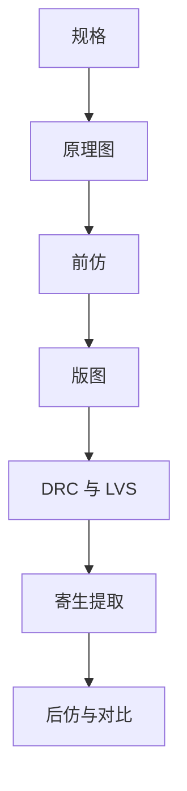

# EE113 数字集成电路 I 及实验

<CourseTable codes="EE113,EE113L" />

课程表采用 **2026–2027 学年**开课数据；内容与考核经验对应 **2026 秋版本**。往届版本教师可能不同，EE113L 独立设课，不能因本页合并介绍而省略选课确认。

## 课程定位

[数字电路](/shanghaitech/courses/ee115b)中的一个逻辑门，在本课里会被拆回晶体管、电阻、电容与真实版图。你将学习为什么同样的逻辑功能会有不同的速度、功耗、面积和可靠性。

官方表中 EE113 先修写为 EE111、EE115；这里保留其原始编号，不擅自解释为只要求 EE115A 或 EE115B。学习上建议同时熟悉基本电路、MOS 工作区、组合与时序逻辑。后续可接 EE213、可测性设计，以及[EE291F](/shanghaitech/courses/ee291f)。[模拟电路](/shanghaitech/courses/ee115a)的小信号分析也能帮助理解器件与负载。

## 内容主线

| 阶段 | 内容 | 学习抓手 |
| --- | --- | --- |
| 器件与流程 | MOS I–V、短沟道效应、CMOS 缩放、VLSI 流程 | 区分模型假设与真实工艺限制 |
| 反相器 | 电压传输特性、翻转阈值、噪声容限 | 从工作区和电流平衡理解信号再生 |
| 时延与功耗 | RC 模型、寄生电容、动态 / 短路 / 漏电功耗 | 明确输入活动、负载、电源与测量条件 |
| 逻辑实现 | 静态 CMOS、动态逻辑、传输门 | 追踪导通路径与弱电平、共享电荷等风险 |
| 优化与算术 | 尺寸优化、逻辑努力（Logical Effort）、加法器与前缀结构 | 比较路径延时、扇出与布线代价 |
| 时序与版图 | 锁存器 / 触发器、建立保持时间、设计规则 | 连接电路时序与物理实现 |

一项优化需要明确“优化什么、代价是什么”。加大尺寸可能降低某段驱动电阻，也会增加前级负载；不能只看局部门延时。

## 实验 / 项目

### EE113L：从反相器走完整流程

2026 秋 Lab0 给出的路线包括器件 I–V 仿真、反相器原理图与分析、反相器版图、寄生提取与后仿，再到复杂门设计及版图集成。工具为 Virtuoso、Spectre / HSPICE 与 Calibre。

设计规则检查（DRC）回答几何是否合规，版图与原理图对比（LVS）核对提取电路与原理图的一致性；两者均不能代替后仿验证时序与性能。

### Final Project：全定制 CPU

2026 秋项目笔记记录了一颗 **16-bit 单周期 CPU** 的晶体管级设计，覆盖程序计数器、寄存器堆、ALU、控制与顶层接口，以及原理图、前仿、全定制版图、DRC / LVS / 寄生提取和后仿。它**不是**把 RTL 交给综合工具自动生成的项目。

建议先冻结接口与指令语义，建立可检查的行为参考；叶子单元通过后再集成模块。前仿正确不代表版图已通过，DRC / LVS 通过也不代表寄生后仿满足性能。课程练习完成更不等于已经制造出芯片。

## 教材与资源

- Rabaey 等，*Digital Integrated Circuits: A Design Perspective*：课程说明中的主要参考。
- Weste / Harris，*CMOS VLSI Design*：补充结构与设计方法。
- [上海科技大学 MOOC 入口](https://mooc.shanghaitech.edu.cn/)：按课程授权获取材料。
- [商业 EDA](/tools/eda/commercial)、[EDA 环境](/tools/development/)：区分工具、许可证与工艺设计套件（PDK）的角色。
- [Cadence 暑期实训](/shanghaitech/courses/cadence-summer)：对照全定制流程与标准单元自动布局布线。

## 往届经验与建议

**2026 秋版本。** 课程说明笔记记录 EE113 为作业 20%、期中 25%、期末 25%、项目 30%，另有额外加分规则；EE113L 笔记记录为 P/NP。两门课分别考核，具体规则以教师通知为准。

- **难点**：近似 RC 模型、串并联门的最坏路径、尺寸与负载的相互影响，以及版图连通和寄生退化。
- **准备**：复习 MOS 工作区与电容充放电。先手算趋势，再用同一组条件仿真，不要让软件输出代替解释。
- **工具链**：尽早跑通建库、原理图、仿真、版图和检查的小闭环。保存设置、模型、测试输入与报告，别只保存最终截图。
- **项目节奏**：复用经过独立验证的单元；模块与顶层分层检查。给布线、LVS 调试、寄生后仿和报告留出时间。
- **授权**：PDK、规则文件和商业工具只能在获授权环境内使用；公开经验时不上传内部资料。

## 相关方向

- [数字 VLSI](/explore-ic/research-directions/digital-vlsi)：电路、时序与功耗优化。
- [EDA](/explore-ic/research-directions/eda)：综合、物理设计与验证算法。
- [器件](/explore-ic/research-directions/devices)：理解工艺缩放与器件模型边界。

::: info 征集
如果你修过 EE113 / EE113L，欢迎通过[参与共建](/community/contributing)补充版本差异与可迁移的调试方法。不要上传 PDK、许可证信息或整套项目答案。
:::

## 参考与来源

- [SIST 2026–2027 学年开课表](https://faculty.sist.shanghaitech.edu.cn/office/Academics/Courses/SIST_2026-2027_Courses.htm)：教师、学分与先修原文。
- 维护者 2026 秋笔记《数字集成电路 I》《EE113 Course Administration — 课程说明》《EE113L Lab0 — Introduction to IC Design & EDA Flow》《EE113 Final Project — 16-bit Single-Cycle CPU》：主线、考核与项目类型；不采用笔记中的个人完成状态作为课程结论。
