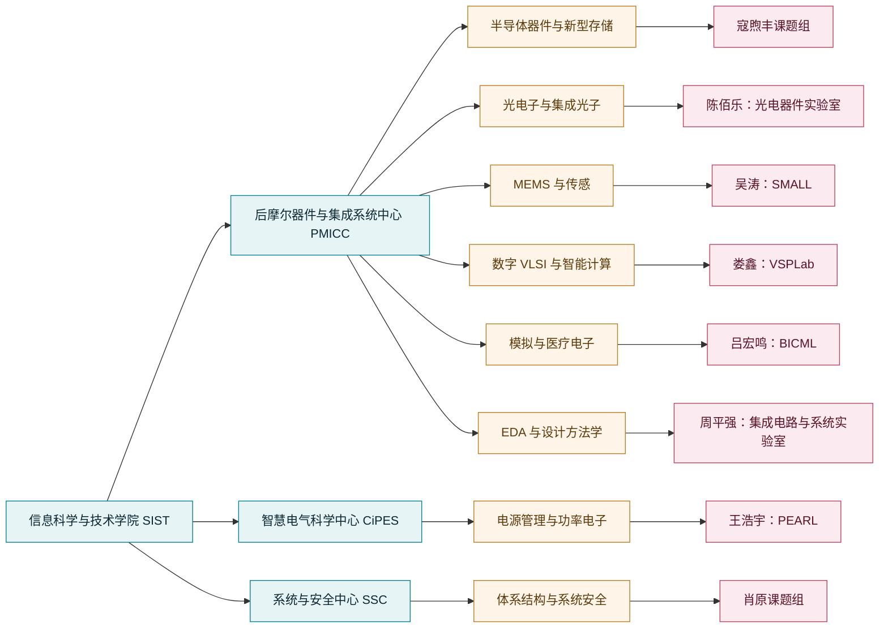

# 上科大 IC 生态

在上海科技大学，集成电路（Integrated Circuit，IC）不是孤立的一门专业课：它连接半导体材料与器件、电路设计、计算机体系结构、设计自动化，也与视觉、医疗电子和能源系统交叉。本板块帮助你把「学什么课、关注哪些老师、在哪里做实验、有哪些培养机会」放到同一张地图上。

## 信息学院：从器件到系统

信息科学与技术学院（School of Information Science and Technology，SIST）设有计算机科学与技术（CS）和电子信息工程（EE）两个本科专业。学院本科招生介绍强调「宽口径、厚基础、重交叉」，并建设导论课、基础课、专业课到高阶课的本硕博一体化课程体系。

**学院官网首页统计口径：截至 2026 年 09 月**，学院有 **1165 名本科生、1727 名研究生、83 个课题组、144 位教授、7 个研究中心**。这些是全学院数据，不能理解为 IC 方向人数或招生名额；不同年份的介绍材料也不宜混为同一统计时点。

学院七个研究中心为：视觉与数据智能中心、智能网络中心、后摩尔器件与集成系统中心、智慧电气科学中心、自动化与机器人中心、系统与安全中心、智能医学信息研究中心。对 IC 学生，以下三个是尤其直接的入口：

| 研究中心 | 与 IC 学习、科研的连接 |
| --- | --- |
| 后摩尔器件与集成系统中心（PMICC） | 覆盖低温电子、自旋电子、光电子、微机电系统、宽禁带半导体，以及低功耗电路、可重构计算、智能 EDA 和定制化片上系统 |
| 智慧电气科学中心（CiPES） | 连接电源管理、功率变换、无线电能传输、宽禁带器件应用与能源系统，适合从「芯片怎样给系统供能」切入 |
| 系统与安全中心（SSC） | 关注计算系统效率与安全，涉及体系结构、存储、高性能计算及软硬件协同安全，与处理器和系统设计相接 |

中心是组织入口，方向是问题入口，两者不是一一对应关系。例如，光计算跨越器件与 AI 硬件，硬件安全既涉及电路也涉及微架构。选方向时应进一步看老师近期论文和项目，而不是只看中心名称。

## 学院—中心—方向—课题组

下面只展示代表性连接，**不是完整组织架构或排名**；课题组与方向依据本站师资数据及学院公开介绍整理。

完整方向与交叉关系见 [科研方向](/research/)，按方向查老师见 [教授与课题组](/shanghaitech/faculty)。

## EE 本科：143 学分如何连接 IC

以下依据 **2026 级电子信息工程本科培养方案**；其他年级应使用本年级版本。方案要求修满至少 **143 学分**，其中人文社科通识 53 学分、自然科学通识 30 学分、专业课程 51 学分、任选课程 9 学分。

专业课程由 **32 学分必修 + 19 学分选修**组成。必修部分包含计算机编程、电路基础及实验、电磁学及课程设计、信号与系统及实验、模拟电路、数字电路，以及毕业论文。这里的基础不只服务于 IC：信号、器件、电磁和编程能力，也为通信、控制、光电与电力电子保留后续选择。

### 专业限选：三选二，不是任选其一

19 学分本学科选修中包含 **8 学分专业限选**，要求从以下三门各 4 学分课程中**至少选两门**：

- **EE120 半导体器件基础**：进一步连接器件、工艺与晶体管工作机制。
- **EE140 通信原理**：连接信号处理与通信系统。
- **EE160 控制原理**：连接动态系统、反馈与控制。

如果三门都修，多余学分计入本学科选修的 19 学分中。不要因为当前偏向数字 IC，就在未核对方案前跳过专业限选要求。

### 面向 IC 的选课思路

- **数字电路与芯片实现**：从 [EE115B 数字电路](/courses/ee115b) 到 [EE113 数字集成电路 I](/courses/ee113)，再接 [EE291F 数字 VLSI 设计流程](/courses/ee291f)。
- **模拟与混合信号**：先打好电路基础、[EE115A 模拟电路](/courses/ee115a) 和 [信号与系统](/courses/ee150)，再进入模拟集成电路与相关实验。
- **器件、光电与 MEMS**：在物理、电磁学、半导体器件基础之上，按研究问题选择工艺、光电与平台实验课程。
- **架构、AI 芯片与 EDA**：结合 [CS110](/courses/cs110)、[EE219](/courses/ee219) 及算法、数学课程，不把写 RTL 与理解系统割裂。

这些是学习建议，不是新增毕业要求。具体课程、先修与开课学期请看 [课程体系](/courses/)。

## 本研一体：按先修能力，而不只按年级选课

学院建设本硕博一体化课程体系，本科阶段可以在满足先修、选课资格和当学期教学安排的条件下申请修读研究生层次课程。例如，EE291F 在课程表中列为研究生课程，先修为 EE113；EE219 也列出了数字电路、数学与编程基础要求。

**研究生课程向本科生开放，不等于所有课程都无条件可选，也不等于自动获得研究生录取资格。** 学分如何计入本科学位、是否需要教师许可，应向教务和任课教师核实。尤其不要仅凭课程代码判断难度，或为提前修课跳过必要实验训练。

## 下一步去哪里

| 你正在找什么 | 推荐入口 |
| --- | --- |
| 课程先后顺序与课程介绍 | [课程体系](/courses/) |
| 老师、方向与公开主页 | [教授与课题组](/shanghaitech/faculty) |
| 微纳加工、EDA 与测试资源 | [科研与工艺平台](/shanghaitech/platforms) |
| 实训、联培与特色项目 | [特色培养项目](/shanghaitech/programs) |
| 各方向解决什么问题 | [科研方向](/research/) |

## 参考与来源

- [信息学院官网](https://sist.shanghaitech.edu.cn/)：首页统计注明「截至 2026 年 09 月」，2026-11 核对。
- [上海科技大学本科生培养方案](https://oaa.shanghaitech.edu.cn/pyfa_4226/list.htm)：教务处入口，按入学年级和专业选择培养方案，同一栏目提供“课表信息”和“课程信息”入口，2026-11-24 核验。
- [走进信息学院七大研究中心，2026-05-06](https://sist.shanghaitech.edu.cn/2026/0506/c10969a1121576/page.htm)。
- [信息学院本科生招生介绍](https://sist.shanghaitech.edu.cn/2711/list.htm)：专业设置、培养特色与本硕博一体化体系。
- [2026 级电子信息工程培养方案](https://faculty.sist.shanghaitech.edu.cn/office/Academics/Undergraduate/Degree%20Programmes/2026%20Bachelor%20Degree%20Prorgams%20in%20EE.htm)：学分及三选二规则；本文依据其本地摘录 `ee2026_rows.txt` 整理。
- [本硕博课程体系与年度开课计划](https://sist.shanghaitech.edu.cn/2835/list.htm)、[2026–2027 学年开课表](https://faculty.sist.shanghaitech.edu.cn/office/Academics/Courses/SIST_2026-2027_Courses.htm)：先修与课程层次，以教务系统为准。
- 课题组示意使用本站 `faculty.ts`、`directions.ts` 的 2026-11 资料版本；具体主页见 [教授与课题组](/shanghaitech/faculty)。
- [本科生 EE 专业选修课分类图](https://faculty.sist.shanghaitech.edu.cn/office/Academics/Undergraduate/Course%20schedule/EE_sample_core_electives.htm)：本科选课指导中包含半导体器件物理、导波光学等高阶课程，并要求关注先修、教学大纲与学分归类；课程层次参照当年开课表。
