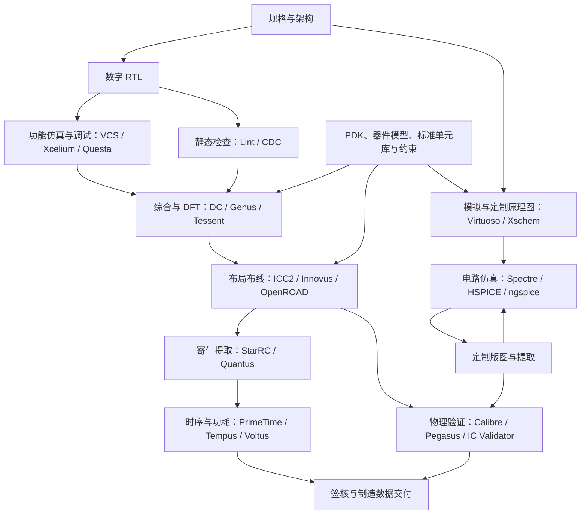

# EDA 工具全景

电子设计自动化（Electronic Design Automation，EDA）是一组贯穿设计、验证与制造准备的软件及方法。初学时最重要的不是背品牌，而是能回答：**我现在处于哪个流程环节？输入是什么？工具产生什么结果？用什么标准检查？** 设计流程的概念解释见 [芯片设计流程](/explore-ic/knowledge-map)。

## 先按任务选入口

| 你的目标 | 推荐入口 | 首先掌握 |
| --- | --- | --- |
| 学 HDL、写测试平台、看波形 | [开源工具链](/tools/open-source/) | 编译、运行、波形与自动检查 |
| 跟随课程完成综合、布局布线或版图实验 | [商用工具链](/tools/eda/commercial) | 课程指定版本、脚本、库文件与报告 |
| 登录课程服务器或使用学院集群 | [环境与 Linux](/tools/development/) | 授权申请、Shell、模块与作业调度 |
| 研究布局、布线、综合或 AI4EDA | [EDA 算法自学](/learning/eda/resources) | 问题定义、合法性、基准和评价方法 |

## 按设计流程看工具地图

下面是教学用的简化关系，不是所有项目的唯一流程。实际项目会在验证、约束、实现和分析之间多次迭代。

**仿真通过、综合成功、生成版图、完成签核是不同的状态。** 功能仿真不能代替静态时序分析，版图查看器能打开 GDS 也不代表设计规则检查通过。签核还依赖指定工具、规则文件、工艺角及项目规范。

## 商用生态与国产工具

国际商用 EDA 生态中，常说的“三巨头”是 [Cadence](https://www.cadence.com/)、[Synopsys](https://www.synopsys.com/) 与 [Siemens EDA](https://eda.sw.siemens.com/)。三家都有跨多个环节的产品；实际项目也可能混用不同厂商工具，并通过网表、约束、版图及寄生参数等文件交换数据。产品同属一个流程环节，不意味着命令、数据库和结果可以直接互换。

国产 EDA 也值得关注，包括**华大九天、概伦电子、芯华章、合见工软**等。阅读其公开产品材料时，按实际任务去核对：支持的设计类型、仿真或验证能力、实现与分析环节、工艺适配，以及可用的培训和许可方式。不要把“国产替代”理解为换一条可执行文件路径，也不要假定学院已经提供所有产品授权。厂商产品覆盖与名称会更新，应以各自官网和平台公告为准。

| 生态 | 适合怎样了解 | 需要留意 |
| --- | --- | --- |
| 商用完整流程 | 结合课程实验理解输入、输出与报告 | 许可证、版本、工艺认证与数据保密 |
| 国产工具 | 从具体产品及实际适配案例入手 | 不把单点能力推广为全流程等价 |
| 开源工具 | 在本地建立可重复实验并阅读实现 | 支持范围、PDK 匹配与签核边界 |

## 工具之外还有三样必需品

1. **工艺设计套件（Process Design Kit，PDK）和库。** 工具安装完成不代表有合法可用的器件模型、设计规则或标准单元库。
2. **约束与方法。** 时钟、输入输出时序、负载、功耗活动率等会改变结果；默认设置通常不能代表真实规格。
3. **可重复记录。** 保存版本、脚本、输入、日志、报告与运行条件，区分警告、失败和可接受的偏差。

在上科大学习时，先跟随课程提供的环境，再考虑迁移到其他服务器或开源流程。迁移前需要确认工具、许可证、工艺数据授权和版本匹配，不应把课程环境中的 PDK 上传到公开仓库或外部服务。

## 与上科大课程配合

<CourseTable codes="EE113L,EE291F,EE215A" />

[EE113L](/shanghaitech/courses/ee113) 的往届资料体现定制电路与版图流程；[Cadence 暑期实训](/shanghaitech/courses/cadence-summer) 的往届资料体现数字实现与签核工具链。它们训练的层次不同，工具安排以当学期通知为准。

## 参考与来源

- [上科大信息学院 2026–2027 学年开课计划](https://faculty.sist.shanghaitech.edu.cn/office/Academics/Courses/SIST_2026-2027_Courses.htm)。
- EE113L Lab0 与 2026 年 Cadence 暑期实训的往届课程笔记：仅用于流程定位，具体工具对应见 [商用工具链](/tools/eda/commercial)。
- Cadence、Synopsys、Siemens EDA 官方主页见正文；通用流程图为本站整理。
